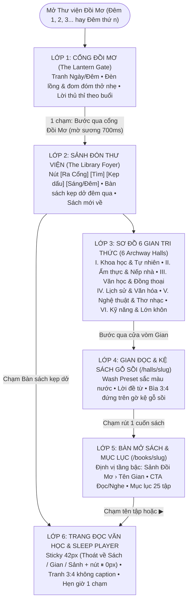

# HỒ SƠ QUY TRÌNH TRẢI NGHIỆM KHÔNG GIAN 6 LỚP & ĐƠN ĐẶT HÀNG THIẾT KẾ — THƯ VIỆN ĐỒI MƠ

| Thuộc tính | Thông tin |
| :--- | :--- |
| **Sản phẩm** | **Thư viện Đồi Mơ** (*Sách đọc và nghe trước giờ ngủ · Copyright © Nancy & Liti*) |
| **Hiến pháp nền tảng** | [GEMINI.md](./GEMINI.md) · [DESIGN_SYSTEM.md](./DESIGN_SYSTEM.md) |
| **Triết lý trải nghiệm** | **Hành trình Không gian 6 Lớp Cho Bạn Đọc Thiếu Nhi & Thiếu Niên**: Đi qua Cổng Đồi Mơ → Bước vào Sảnh Đón → Chọn 1 trong 6 Gian Tri Thức → Ngắm Kệ Sách Gỗ Sồi → Rút Sách mở Bàn Mục Lục → Đắm chìm Trang Đọc & Giấc ngủ Êm |
| **Kho sách & 6 Gian** | Hệ thống **6 Gian Tri Thức** (`Khoa học & Tự nhiên` · `Ẩm thực & Nếp nhà` · `Văn học & Đồng thoại` · `Lịch sử & Văn hóa` · `Nghệ thuật & Thơ nhạc` · `Kỹ năng & Lớn khôn`), tương thích trực tiếp với ô chọn trong `/admin` |
| **Trạng thái tài liệu** | Bản đặc tả Không gian 6 Lớp đã chốt qua `/grill-me` (Đồng bộ Stitch + Web App Next.js) |

---

## PHẦN I. TRIẾT LÝ TRẢI NGHIỆM DÀNH CHO BẠN ĐỌC THIẾU NHI & THIẾU NIÊN

### 1. Vì sao trẻ em & thiếu niên cần "Ngưỡng cửa" ở MỌI đêm đọc?
Khác với ứng dụng tiện ích của người lớn luôn muốn cắt bỏ mọi bước đệm để bấm nút nhanh nhất, **trẻ em và thiếu niên đọc sách trước giờ ngủ cần một nghi thức bước vào thế giới truyện (*Spatial Threshold*)**:
- Khi bước vào một thư viện thật ngoài đời, đứa trẻ không bao giờ bị "thả rơi" ngay giữa giá sách. Em nhìn thấy **Cổng thư viện dưới gốc cây sồi sáng đèn lồng**, hít một hơi bình yên, đẩy cửa bước vào **Sảnh Đón ấm áp**, ngước nhìn bảng chỉ dẫn **6 Gian Tri Thức**, bước chân vào **Gian yêu thích**, ngắm các cuốn sách bày ngay ngắn trên **Kệ Gỗ Sồi**, rồi mới **rút 1 cuốn sách** đặt lên bàn mở mục lục và đọc/nghe.
- Dù là đêm thứ 1, đêm thứ 2 hay đêm thứ `n`, khoảnh khắc dừng chân 2 giây trước **Cổng Đồi Mơ** trước khi màn sương hé mở vào Sảnh chính là ranh giới dịu dàng tách rời sự ồn ào ban ngày để bước vào thế giới của tri thức và tưởng tượng.

### 2. Nguyên tắc Cân bằng Giữa "Chất Thơ Không Gian" & "Công Thái Học Ngón Cái"
- **Mở đầu luôn chạm cảm xúc, nhưng không bao giờ rườm rà:**
  1. **Mở cổng chỉ đúng 1 chạm (`Bước qua cổng Đồi Mơ →`):** Không bắt nhập mật khẩu, không có màn hình hướng dẫn dài dòng, không tự phát tiếng động giật mình phòng ngủ.
  2. **Tái lập ngưỡng cửa theo phiên đọc (45 phút / phiên mới):** Mở app buổi tối hôm sau (hoặc quay lại sau `45 phút`), **Cổng Đồi Mơ** luôn hiện ra chào đón như một nghi thức. Nhưng trong cùng 1 buổi đọc, khi người đọc lùi từ Trang Đọc → Mục Lục → Kệ Gỗ → Sảnh, họ đi lại tự do giữa Sảnh và các Gian (và luôn có nút `[Ra Cổng]` ở góc Sảnh để ngắm lại Cổng bất cứ lúc nào).
  3. **Bàn Sách Kẹp Dở Đêm Qua đặt ngay tại Sảnh Đón:** Vừa qua cổng là thấy ngay cuốn sách đang đọc/nghe dở đặt sẵn trên bàn đón khách để đi thẳng vào câu chuyện trong `1` chạm nếu muốn tiếp nối mạch đêm qua, song song với Sơ đồ **6 Gian Tri Thức** bên dưới.

---

## PHẦN II. KIẾN TRÚC HÀNH TRÌNH KHÔNG GIAN 6 LỚP (*THE 6-LAYER SPATIAL JOURNEY*)

### Đặc tả Chi tiết Từng Lớp Không Gian

| Lớp | Tên Không Gian | Route / Trạng thái | Thành phần Cốt lõi & Cảm giác Thị giác |
| :-: | :--- | :--- | :--- |
| **1** | **Cổng Đồi Mơ** | `/` (`!hasPassedGate`) | Vòm cửa gỗ sồi cổ kính lồng tranh Đồi Mơ Ngày (`doi-mo-day.jpg`) hoặc Đêm (`doi-mo-night.jpg` tự động `19:30–05:30`), quầng đèn lồng `.lantern-aura`, đom đóm `.firefly-dot`, lời chào theo buổi, nút `Bước qua cổng Đồi Mơ →` hiệu ứng mở sương `700ms`. |
| **2** | **Sảnh Đón Thư Viện** | `/` (`hasPassedGate`) | Header `Sảnh Đồi Mơ` kèm nút `[Ra Cổng]`, `[Tìm]`, `[Kẹp dấu]`, `[Sáng/Đêm]`; khối **Bàn Sách Đang Kẹp Dở Đêm Qua** (hợp nhất Đọc & Nghe) và **Sách Mới Về Sảnh**. |
| **3** | **6 Gian Tri Thức** | `/` (phần trung tâm Sảnh) | Lưới 2 cột 6 cửa vòm gỗ (`rounded-t-[24px]`): Gian I (*Khoa học & Tự nhiên*) & Gian II (*Ẩm thực & Nếp nhà*) sáng đèn ấm báo số sách; Gian III–VI để ánh đèn dịu *"Đang xếp sách mới..."*. |
| **4** | **Gian Đọc & Kệ Gỗ Sồi** | `/halls/[slug]` | Header dính `← Sảnh Đồi Mơ`; đầu gian wash màu nước Preset `8–10%`, biểu tượng SVG nét mảnh & lời đề từ; các bìa `3:4` sạch đứng trên gờ **Kệ Gỗ Sồi** ấm áp kèm lời mời *Rút sách mở mục lục →*. |
| **5** | **Bàn Mở Sách & Mục Lục** | `/books/[slug]` | Thanh định vị tầng bậc `Sảnh Đồi Mơ › Tên Gian` giúp lùi lại đúng tầng không gian; nút CTA thông minh + chọn Giọng đọc; mục lục mật độ cao `CHUNK_SIZE = 25`. |
| **6** | **Trang Đọc & Sleep Player** | `/episodes/[id]` & Drawer | Tuân thủ 100% Điều 1 `GEMINI.md`: `Sticky 42px` có `[← Tên sách]`, `[Tên Gian]` & `[Sảnh]`, nút `[⏸]` `0px` khi cuộn sâu; tranh `3:4` không caption; `0` hộp cuối tập; `Full-screen Sleep Player` có Khóa chạm `2s` & thanh Hẹn giờ 1 chạm *Hết tập dừng êm* `8s`. |

---

## PHẦN III. HỆ THỐNG 6 GIAN TRI THỨC & TƯƠNG THÍCH QUẢN TRỊ (`/admin`)

1. **Gian I — Khoa học & Tự nhiên** (`khoa-hoc-tu-nhien`, Preset `Moss`): *Lim và Mẹ Vacci* cùng các bộ sách khám phá sinh học, rừng cây, thiên văn, khoa học thường thức.
2. **Gian II — Ẩm thực & Nếp nhà** (`am-thuc-nep-nha`, Preset `Ochre`): *Tiểu Hạt Dẻ Thích Ăn Vụng* cùng các bộ sách về căn bếp ấm, nông sản, ẩm thực, đời sống gia đình.
3. **Gian III — Văn học & Đồng thoại** (`van-hoc-dong-thoai`, Preset `Rosewood`): Truyện kể, ngụ ngôn, đồng thoại nuôi dưỡng tâm hồn.
4. **Gian IV — Lịch sử & Văn hóa** (`lich-su-van-hoa`, Preset `Ochre`): Dòng chảy lịch sử, danh nhân, phong tục và di sản văn hóa.
5. **Gian V — Nghệ thuật & Thơ nhạc** (`nghe-thuat-tho-nhac`, Preset `Lavender`): Hội họa, âm nhạc, thơ thiếu nhi và khúc hát ru đêm.
6. **Gian VI — Kỹ năng & Lớn khôn** (`ky-nang-lon-khon`, Preset `Moss`): Cảm xúc, thói quen tốt, lòng nhân ái và kỹ năng tự lập.

Trong `/admin/books/[id]`, Chủ thư viện chọn trực tiếp **1 trong 6 Gian** bằng nút thẻ trực quan (có thể kèm nhánh chủ đề phụ ngắn gọn), hệ thống tự mã hóa vào trường `genreTag` sẵn có nên không làm gián đoạn cơ sở dữ liệu Supabase hay JSON cục bộ.

---

## PHẦN IV. RÀO CHẮN HIẾN PHÁP `GEMINI.md` & ĐƠN ĐẶT HÀNG DESIGN

Mọi bản vẽ UI (Stitch MCP) và mã nguồn Frontend đều bất biến tuân thủ **Phương án A — Ấn Bản Giấy Cotton (`Botanical Paper Edition`)**:
- Ban ngày (`#F8F5EE` / `#F1ECE1` / `#FDFBF6` / `#222923` / `#354F3E` / `#9E7B43`) và Ban đêm (`#111613` / `#19201C` / `#212A24` / `#EFE9DC` / `#89A892` / `#D4AC6E`), tự động kích hoạt Đêm ấm lúc `19:30–05:30`.
- `134/134` ký tự tiếng Việt qua `Lora` + `Be Vietnam Pro`; cấm `Iowan Old Style`, `Charter`, `Athelas`, `Hoefler Text`, `Palatino`.
- **Ngôn ngữ tự nhiên, không khẩu hiệu (*Zero Slogans / Natural Micro-copy*):** Giao diện Cổng, Sảnh và các Gian giữ sự điềm đạm mộc mạc; tránh dùng khẩu hiệu, số La Mã trang trí hay lời mời mọc tô vẽ (*0* "mời bạn nhỏ đẩy nhẹ", *0* "nuôi dưỡng tâm hồn", *0* "rút sách mở mục lục").
- **5 Tuyệt Đối Không:** `0` emoji hệ điều hành (100% SVG nét mảnh `1.4px`), `0` tem nhãn đè lên bìa `3:4`, `0` *"Kỷ vật trong túi da"* / hộp cuối tập, `0` `caption` dưới tranh trong bài đọc, `0` Bottom Tab Bar / FAB `+` / Glassmorphism SaaS.
