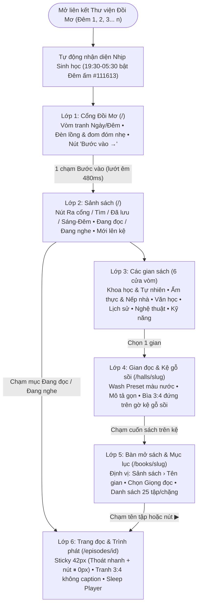

# QUY TRÌNH VẬN HÀNH & TRẢI NGHIỆM — THƯ VIỆN ĐỒI MƠ

| Thuộc tính | Thông tin |
| :--- | :--- |
| **Sản phẩm** | **Thư viện Đồi Mơ** (*Sách đọc và nghe trước giờ ngủ · Copyright © Nancy & Liti*) |
| **Hiến pháp bất biến** | [GEMINI.md](./GEMINI.md) |
| **Tài liệu song hành** | [CAM_NANG_THU_VIEN_DOI_MO.md](./CAM_NANG_THU_VIEN_DOI_MO.md) · [PROJECT_JOURNAL.md](./PROJECT_JOURNAL.md) · [OPTIMAL_UX_DESIGN_BRIEF.md](./OPTIMAL_UX_DESIGN_BRIEF.md) |
| **Phạm vi** | Chuẩn hóa 3 quy trình cốt lõi: (1) Trải nghiệm bạn đọc 6 lớp không gian, (2) Đưa sách lên kệ qua `/admin`, (3) Đặt hàng mở rộng với AI Agent |

---

## QUY TRÌNH 1: HÀNH TRÌNH TRẢI NGHIỆM BẠN ĐỌC QUA 6 LỚP KHÔNG GIAN

Được thiết kế cho bạn đọc thiếu nhi, thiếu niên và gia đình vào mỗi tối trước giờ ngủ (hoặc ban ngày cuối tuần): bước vào thư viện một cách từ tốn, tự nhiên, không rào cản đăng nhập và không khẩu hiệu gượng ép.

### Chi tiết vận hành từng lớp trên giao diện thực tế (`src/**`)

1. **Lớp 1 — Cổng Đồi Mơ (`/` khi `!hasPassedGate`):**
   - Mỗi khi mở phiên trình duyệt mới hoặc quay lại sau `≥ 45 phút` nghỉ (`GATE_RESET_IDLE_MS`), bạn đọc luôn bắt gặp **Cổng Đồi Mơ** để có khoảng lặng trước khi vào sách.
   - Tự đổi ảnh vòm theo giờ (`public/images/home/doi-mo-night.jpg` trong khung `19:30–05:30`; `doi-mo-day.jpg` vào ban ngày) với ánh đèn lồng & đom đóm dịu nhẹ (`0` âm thanh bất ngờ).
   - Chạm **`Bước vào →`** để lướt êm (`480ms`) vào Sảnh sách. (Bất kỳ lúc nào ở Sảnh cũng có nút `ArchDoorIcon` để quay ra ngắm lại Cổng).

2. **Lớp 2 — Sảnh sách (`/` khi `hasPassedGate`):**
   - **Thẻ `Đang đọc` / `Đang nghe` / `Tập tiếp theo`:** Hợp nhất cả hai loại sách (sách nói + sách chữ như *Tiểu Hạt Dẻ*) theo thời gian đọc/nghe gần nhất (`updatedAt`), cho phép tiếp tục đúng giây đang nghe hoặc đúng `%` trang đang đọc chỉ với 1 chạm.
   - **Kệ `Mới lên kệ`:** Hiển thị tối đa `3` tập mới trong `14 ngày` gần nhất; tự động biến mất khỏi danh sách của thiết bị ngay sau khi bạn đọc đã mở đọc hoặc phát nghe tập đó.
   - **Ngăn trượt Tiện ích (`SearchAndSavedSheet`):** Chạm biểu tượng Kính lúp hoặc Bookmark trên Header để tìm sách/tập toàn thư viện và xem danh sách đã đánh dấu, không chiếm `58px` thanh Tab đáy màn hình.

3. **Lớp 3 & 4 — Các gian sách & Kệ gỗ sồi (`/halls/[slug]`):**
   - Sảnh bày 6 cửa vòm phân loại rõ ràng (gian có sách thắp chấm đèn ấm kèm số bộ sách/số tập; gian chưa có sách ghi nhẹ *Sắp có sách*).
   - Bước vào từng gian là không gian tĩnh lặng có sắc màu nước Preset đặc trưng (`Moss`, `Ochre`, `Rosewood`, `Lavender`) và **thanh kệ gỗ sồi** nâng đỡ các bìa sách `3:4` sạch tuyệt đối (`0` tem nhãn đè lên mặt tranh).

4. **Lớp 5 — Bàn mở sách & Mục lục (`/books/[slug]`):**
   - Thanh định vị đầu trang (`← Sảnh sách › Tên gian`) giúp người đọc luôn biết vị trí cuốn sách đang cầm và dễ dàng lùi lại đúng kệ sách cũ.
   - Áp dụng *Progressive Disclosure*: sách `≤ 15` tập thu gọn thanh tìm kiếm; sách `≤ 25` tập hiển thị liền một mạch không chia chặng lẻ; trên mỗi hàng tập, chạm tiêu đề/ảnh nhỏ để **Đọc chữ**, chạm nút tròn `▶` bên phải để **Nghe ngay**.

5. **Lớp 6 — Trang đọc văn học & Trình phát ru ngủ (`/episodes/[id]` & `FullScreenPlayerDrawer`):**
   - **Trang đọc chữ:** Thanh đỉnh dính `42px` luôn giữ lối thoát về sách mẹ & `Sảnh sách`; khi vừa nghe audio vừa cuộn đọc xuống giữa bài dài, nút tròn `[⏸ / ▶]` tự hiện ngay trên thanh `Sticky 42px` mà không tốn `1px` chiều cao thêm; tranh minh họa cuộn dọc gọn trong màn hình (`0` caption, `0` hộp cuối tập); vị trí cuộn trang tự động lưu mỗi `500ms`.
   - **Trình phát ru ngủ toàn màn hình:** Đầy đủ `Khóa chạm` (giữ `2 giây` để mở khóa), tua `±15 giây`, đổi giọng đọc giữ nguyên tỷ lệ thời gian, và **Thanh Hẹn giờ 1 chạm (`Hết tập dừng êm · 15p · 30p · Liên tiếp`)**. Từ `19:30–05:30`, hệ thống tự mặc định *Hết tập dừng êm* với hiệu ứng giảm dần âm lượng trong `8 giây` cuối tập rồi dừng hẳn để trẻ không bị đánh thức sang tập mới.

---

## QUY TRÌNH 2: ĐƯA SÁCH MỚI LÊN THƯ VIỆN QUA XƯỞNG SÁCH (`/admin`)

> **Ranh giới quy trình:** Khâu viết truyện, biên tập văn bản gốc và vẽ tranh minh họa thực hiện ở dự án sáng tác độc lập bên ngoài. Xưởng Sách `/admin` chỉ tiếp nhận thành phẩm đã hoàn chỉnh để xuất bản lên Thư viện.

| Bước | Thực hiện tại | Thao tác chuẩn của Chủ thư viện | Tiêu chí kiểm tra trước khi chuyển bước |
| :-: | :--- | :--- | :--- |
| **1** | Ngoài thư viện (Kho thành phẩm) | Gom đủ bộ tài liệu cho 1 Bộ sách / Tập: ảnh bìa `3:4` sạch (không chữ đè góc), file Markdown văn bản chuẩn Unicode NFC, bộ tranh dọc (nếu có), file âm thanh MP3/M4A `48kHz` (nếu là sách nói). | Ảnh `≤ 5MB`, Audio `≤ 60MB`/bản thu; văn bản sạch không chứa hộp ghi chú cuối tập. |
| **2** | `/admin` → `Giọng đọc` | Tạo hoặc đối chiếu **Hồ sơ Giọng đọc (`VoiceProfile`)** dùng chung toàn thư viện (ví dụ `Nữ · Mỹ Duyên`, `Nam · Thiền Tâm Đức`). | Đảm bảo mỗi giọng đọc có `voiceKey` duy nhất và `displayName` ngắn gọn (tối đa ~20 ký tự để không tràn thanh `38px`). |
| **3** | `/admin/books/new` (hoặc `/admin/books/[id]`) | Nhập tên sách, tác giả, họa sĩ, độ tuổi; tải bìa `3:4` và chọn **Điểm căn (`Trên/Giữa/Dưới`)**; chọn **Gian sách * (1 trong 6 Gian)** + nhánh chủ đề phụ; chọn Preset màu nước; tick **Xác nhận quyền sở hữu/lưu hành**. | Lưu ở trạng thái `Nháp` nếu chưa có tập nào; chỉ bật `Xuất bản sách` khi đã có ít nhất `1` tập đã xuất bản. |
| **4** | `/admin/episodes/[id]` | Biên tập Tập qua 4 tab: (1) *Thông tin*, (2) *Audio* (hoặc bật *Chỉ đọc chữ*), (3) *Tranh minh họa*, (4) *Bản chữ Markdown* (tự lưu nháp mỗi 3s). Bấm **Xem trước 390px** để kiểm tra. | Kiểm tra Pre-publish Checklist xanh đủ; đảm bảo không đè mất dấu tiếng Việt (`Ấ, Ề, Ổ, Ứ, ệ, ộ, ợ`). |
| **5** | `/admin` | Bấm **Xuất bản** tập → kiểm tra hiển thị thực tế trong Gian sách tương ứng. Định kỳ cuối tuần bấm **Sao lưu JSON** tải tệp dự phòng về máy. | Tập mới tự động xuất hiện ở mục `Mới lên kệ` trên Sảnh và nằm gọn trong Gian sách đã chọn. |

---

## QUY TRÌNH 3: ĐẶT HÀNG NÂNG CẤP GIAO DIỆN & TÍNH NĂNG VỚI AI AGENT

Khi muốn thiết kế thêm màn hình hoặc mở rộng tính năng trong tương lai, thực hiện theo trình tự 4 cổng kiểm soát:

1. **Cổng 1 — Đối soát Hiến pháp & Cẩm nang:** Đọc lại [GEMINI.md](./GEMINI.md) và [CAM_NANG_THU_VIEN_DOI_MO.md](./CAM_NANG_THU_VIEN_DOI_MO.md). Tuyệt đối không đưa thêm Bottom Tab Bar, nút FAB `+`, emoji hệ điều hành, huy hiệu điểm thưởng EdTech hay hộp phụ cuối bài đọc.
2. **Cổng 2 — Rà soát Ngôn ngữ Tự nhiên:** Loại bỏ mọi từ ngữ khẩu hiệu, số La Mã rườm rà hay câu dẫn giả tạo trước khi viết Prompt hoặc viết code.
3. **Cổng 3 — Dựng Mockup Kiểm duyệt (nếu thay đổi bố cục lớn):** Dùng Google Stitch MCP (`create_project` → `generate_screen_from_text` với `deviceType: "MOBILE"`, tải file qua `download_file`), kiểm tra bằng mắt để chắc chắn không có URL ảnh vỡ (`aida/ALJJyr...`) hoặc chi tiết SaaS lọt vào.
4. **Cổng 4 — Thi công Code & Kiểm chứng:** Cập nhật mã nguồn Next.js trong `src/**`, giữ tương thích ngược với cả Supabase và `data/library_db.json`, sau đó chạy kiểm tra `npm run typecheck && npm run build`.
