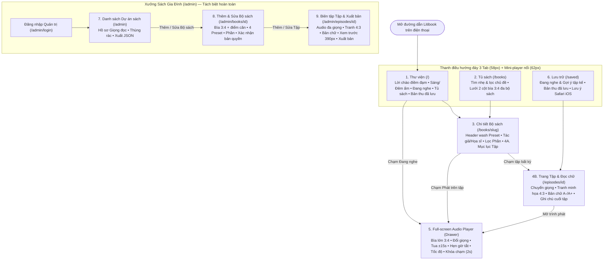
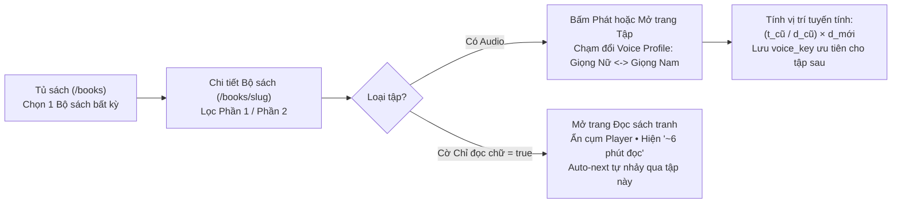

# UX FLOWS & INFORMATION ARCHITECTURE — Litibook (Phase 2)

| Thuộc tính | Thông tin |
| :--- | :--- |
| **Tham chiếu sản phẩm** | [PRD.md](./PRD.md) (Release 1.0 · Tài liệu v1.2 — Đã phê duyệt chính thức) |
| **Phạm vi thiết kế** | Kiến trúc Thông tin (IA) & Luồng tương tác Mobile-first (`390px`) |
| **Nguyên tắc cốt lõi** | 2 chạm để phát truyện · Một tay thao tác đêm · Văn phong sách in điềm đạm · Không emoji/quảng cáo |

---

## 1. Phân tích UX từ `PRD.md` v1.2

### 1.1. Mô hình "Hai lớp người dùng trên một mái nhà"
Litibook phục vụ đồng thời hai ngữ cảnh đối lập nhưng cùng chung ngôn ngữ sách nghệ thuật ấm áp:

| Lớp trải nghiệm | Đối tượng | Tâm thế sử dụng | Quy tắc UX bắt buộc |
| :--- | :--- | :--- | :--- |
| **Khu vực Người nghe** (`/`, `/books`, `/saved`, `/episodes`) | Phụ huynh, ông bà, bạn thân và trẻ 3–10 tuổi | Buổi tối ánh sáng yếu, đọc cùng con hoặc ru ngủ một tay | **Tối đa 2 chạm** để phát tập đang nghe; vùng chạm `≥ 44×44px` ở nửa dưới màn hình (`thumb-zone`); **không có liên kết thoát ra web ngoài** và giấu hoàn toàn lối vào quản trị. |
| **Xưởng Sách Gia Đình** (`/admin/*`) | Chủ thư viện (không chuyên lập trình) | Cuối tuần biên tập truyện, tải audio 48kHz & tranh trên laptop hoặc kiểm nhanh trên điện thoại | Thiết kế như **"Xưởng đóng sách gia đình"** nền giấy ấm (không biểu đồ KPI, không sidebar SaaS lạnh); chống mất bản chữ khi rớt mạng và luôn có **Xem trước `390px`** trước khi xuất bản. |

### 1.2. Cơ chế Đa dự án sách (Multi-Book Architecture)
Thay vì thiết kế một ứng dụng đóng cứng cho duy nhất bộ *Lim & Mẹ Vacci*, UX của Litibook tách bạch rạch ròi:
- **85% Hệ khung chung (Platform Shell):** Cấu trúc mở thẳng không rào cản đăng nhập, 3 tab điều hướng đáy (`Thư viện` · `Tủ sách` · `Lưu trữ`), thẻ *Đang nghe*, trình đọc chữ, Mini-player & Full-screen Player giữ cố định để người nghe mở bộ sách nào cũng thấy quen tay ngay lập tức.
- **15% Bản sắc từng Bộ sách (Book Identity):** Mỗi bộ sách có bìa màu nước `3:4` sạch sẽ (không dán nhãn đè góc), chọn **1 trong 4 Preset sắc thái màu nước** (chỉ nhuộm nhẹ phần đầu trang bộ sách `8–10%` độ đậm để giữ tương phản chữ WCAG AA), tùy chọn bật/tắt nhãn **Ghi chú cuối tập** (VD: *"Kỷ vật trong túi da"* cho *Lim & Mẹ Vacci*, hoặc tắt hẳn cho *Khúc Ru Thung Lũng*), và cấu hình mặc định `Auto-next`.

---

## 2. Information Architecture (Kiến trúc Thông tin)

### 2.1. Bản đồ Điều hướng Tổng thể (Navigation Map)



### 2.2. Giải trình cấu trúc 3 Tab + Trang gộp Chi tiết Bộ sách & Mục lục Tập
- **Thanh điều hướng 3 Tab (`Thư viện` · `Tủ sách` · `Lưu trữ`):** Trên chiều rộng `350px` khả dụng, mỗi tab rộng `116px × 58px` rất chuẩn xác khi thao tác một tay trong bóng tối và giữ sự tĩnh lặng của một tủ sách gia đình.
- **Gộp Trang Chi tiết Bộ sách (Màn hình 3) & Danh sách Tập (Màn hình 4A):** Cuộn liền mạch từ phần giới thiệu bộ sách xuống bộ lọc `Phần` và mục lục tập giúp giảm thao tác bấm thừa; chạm vào tên tập mới mở trang Đọc Bản chữ & Xem Tranh (`Màn hình 4B`).

---

## 3. Sáu Luồng Tương tác Cốt lõi (Core UX Flows)

### Flow 1: Truy cập Thư viện Trực tiếp — Không Rào cản Đăng nhập hay Mã mời
1. Người thân hoặc bạn bè nhận đường dẫn Litibook qua tin nhắn và bấm mở trên điện thoại.
2. Ứng dụng đưa thẳng vào **Màn hình 1: Trang chủ Thư viện (`/`)** ngay lập tức — **không cổng mã mời, không bắt tạo tài khoản hay nhập mật khẩu**.
3. Mọi dữ liệu cá nhân của người nghe (tập đang nghe dở, vị trí giây, giọng đọc ưu tiên, danh sách bản thu đã lưu, chế độ Sáng/Đêm) được lưu tự động ngay trên trình duyệt của thiết bị đó (`localStorage`).
4. Chỉ khu vực **Xưởng Sách Gia Đình (`/admin`)** yêu cầu đăng nhập tài khoản Quản trị viên duy nhất của Chủ thư viện để bảo vệ quyền thêm, sửa, xóa và xuất bản sách.

### Flow 2: Nghi thức Giờ đi ngủ 30 giây bằng Một tay (`LIS-002`, `LIS-006`, `PLY-003`, `PLY-006`)
1. Phụ huynh mở Litibook buổi tối → chạm icon **Mặt trăng** nét mảnh góc trên phải để chuyển sang *Đêm ấm ru ngủ*.
2. Ngay đầu trang là thẻ **Đang nghe** (`LIS-002`):
   - Nếu Tập 01 dừng dở ở `05:30` → chạm nút **Phát** mảnh (`44×44px`) phát tiếp từ `05:27` (lùi 3s bắt nhịp).
   - Nếu Tập 01 hôm qua đã nghe xong (`≥ 95%`) → thẻ tự gợi ý **"Gợi ý tập kế: Tập 02"** để 1 chạm phát từ `00:00`.
3. Mini-player nổi lên ở đáy → chạm mở **Full-screen Player** → chạm **Hẹn giờ (`15 phút` hoặc `Hết tập này`)** → khóa màn hình điện thoại.
4. Trên màn hình khóa: hiển thị tên tập, tên bộ sách, bìa sách và nút `Phát/Dừng`, `Tua ±15s`. Khi hết giờ hẹn: Android/Desktop giảm dần âm lượng `8 ± 2 giây` rồi dừng; iOS dừng chính xác tại mốc (`±2 giây`) và lưu nguyên vị trí.

### Flow 3: Duyệt Đa bộ sách, Đổi Giọng đọc & Tập *"Chỉ đọc chữ"* (`LIS-003`..`004`, `PLY-005`, `OPD-03`)


### Flow 4: Xem tranh cùng con & Khóa chạm (`Kid Lock`) (`LIS-005`, `PLY-010`)
1. Khi đưa điện thoại cho trẻ ngắm bìa tranh trên Full-screen Player, phụ huynh bấm nút **Khóa chạm** (icon ổ khóa nét mảnh ở đỉnh trình phát).
2. **Trạng thái khóa chạm:** Thanh tua và toàn bộ nút điều khiển mờ đi và ngừng nhận chạm đơn; bìa tranh giữ nguyên sắc độ dịu; đáy màn hình hiện viên thuốc nhỏ: *"Giữ 2 giây để mở khóa"*.
3. **Mở khóa:** Chạm giữ đủ `2 giây` để khôi phục quyền điều khiển.
4. Tại trang đọc tập (`Màn hình 4B`), chạm vào tranh `4:3` để mở **Lightbox toàn màn hình** vuốt xem từng trang tranh kèm chú thích.

### Flow 5: Lưu Yêu thích & Bảo toàn Lịch sử nghe iOS (`LIS-008`, `LIS-009`, `DEC-03`)
- Trên mỗi hàng mục lục tập (`Màn hình 4A`) hoặc Full-screen Player, chạm icon **Đánh dấu (Bookmark / Star)** (`44×44px`) để lưu vào tab **Lưu trữ (`Màn hình 6`)**.
- **Xử lý giới hạn 7 ngày trên iOS Safari:** Nếu phát hiện người nghe đang mở trên Safari iOS ở trình duyệt thường và đã có tiến độ nghe, hiển thị hộp lưu ý giấy kem nhẹ ở cuối tab *Lưu trữ*: *"Chọn Chia sẻ → Thêm vào Màn hình chính để giữ lịch sử nghe lâu dài trên iPhone"*.

### Flow 6: Xuất bản Tập mới không cần chạm code (`ADM-003`..`010`, `PUB-001`..`003`)
```mermaid
flowchart TD
    S1["Màn hình 7 (/admin)<br/>Chọn Bộ sách hoặc '+ Tạo Bộ Sách Mới'"] --> S2["Màn hình 8 (/admin/books/id)<br/>Nhập thông tin • Tải bìa 3:4 (chọn tâm Trên/Giữa/Dưới)<br/>Chọn Preset màu nước • Tick Xác nhận quyền sử dụng"]
    S2 --> S3["Màn hình 9 (/admin/episodes/id)<br/>Tab 1: Thông tin • Tab 2: Voice Profile & Audio (<=60MB)<br/>Tab 3: Tranh 4:3 (<=15 tranh) • Tab 4: Bản chữ (tự lưu 3s)"]
    S3 --> CHK{"Kiểm tra Pre-publish Checklist"}
    CHK -->|Lỗi mạng khi upload| RETRY["Báo lỗi tại ô upload + nút 'Thử tải lại'<br/>GIỮ NGUYÊN 100% bản chữ đã nhập"]
    RETRY --> S3
    CHK -->|Thiếu Tiêu đề / Audio (chưa bật Chỉ đọc chữ)| BLOCK["Khóa nút Xuất bản & chỉ rõ mục thiếu"]
    CHK -->|Đạt chuẩn| PRE["Bấm 'Xem trước 390px' kiểm tra trên khung di động"]
    PRE --> PUB["Bấm 'Xuất bản' -> Tập hiện ngay bên Người nghe (<= 2s)"]
```
