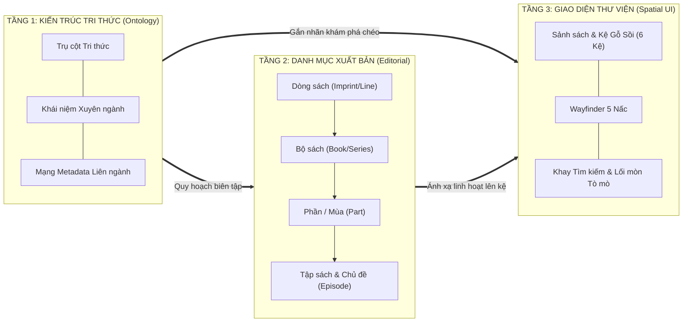
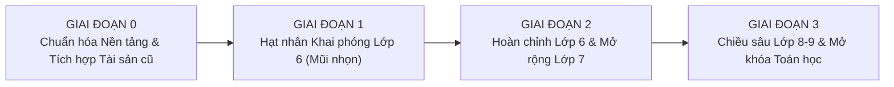

# KIẾN TRÚC TRI THỨC & QUY HOẠCH DANH MỤC XUẤT BẢN DÀI HẠN — THƯ VIỆN ĐỒI MƠ (11–15 TUỔI, TRỌNG TÂM LỚP 6)

| Thuộc tính Hồ sơ | Nội dung Định chuẩn |
| :--- | :--- |
| **Đơn vị thụ hưởng** | **Thư viện Đồi Mơ** (*Sách đọc và nghe trước giờ ngủ · Copyright © Nancy & Liti*) |
| **Trạng thái văn bản** | **Đã phê duyệt chính thức (`27/11/2026`)** — Phiên bản `v2.0` |
| **Đối tượng mục tiêu** | Thiếu niên **11–15 tuổi** (cấp THCS), ưu tiên mũi nhọn giai đoạn đầu: **Học sinh Lớp 6 (11–12 tuổi)** tại Việt Nam |
| **Giới hạn phạm vi hiện tại** | Giáo dục khai phóng qua sách nói & bản đọc tinh tuyển; **chưa phát triển dòng sách Toán học**; **chưa sáng tác truyện** |
| **Tham chiếu nội bộ** | [GEMINI.md](../../GEMINI.md) · [CAM_NANG_THU_VIEN_DOI_MO.md](./CAM_NANG_THU_VIEN_DOI_MO.md) · [halls.ts](../../src/lib/halls.ts) · [types.ts](../../src/lib/types.ts) · [library_db.json](../../data/library_db.json) |

---

## MỞ ĐẦU. PHƯƠNG PHÁP LUẬN & SỰ PHÂN TÁCH BA TẦNG KIẾN TRÚC

### 1. Bối cảnh chuyển dịch của Thư viện Đồi Mơ
Hiện tại, **Thư viện Đồi Mơ** đã định hình vững chắc nền tảng kỹ thuật và mỹ thuật *Ấn Bản Giấy Cotton (Botanical Paper Edition)* với 2 bộ sách đầu tiên hướng tới lứa tuổi `4–10` ([library_db.json](../../data/library_db.json)). Việc mở rộng sang phân khúc **thiếu niên 11–15 tuổi (bắt đầu từ học sinh Lớp 6)** không đơn thuần là "viết dài hơn" hay "thêm kiến thức khó hơn", mà là một bước chuyển về **nhận thức luận và tâm lý phát triển**: người nghe bước ra khỏi tư duy đồng thoại ấu thơ để bước vào giai đoạn tư duy trừu tượng, đi tìm bản sắc cá nhân và giải mã thế giới rộng lớn.

> [!IMPORTANT]
> **Nguyên tắc Ranh giới Cốt lõi (Chống "Sách giáo khoa hóa âm thanh"):**
> Thư viện Đồi Mơ tuyệt đối không làm nhiệm vụ giảng bài, tóm tắt bài học, ôn thi hay đọc định nghĩa sách giáo khoa thành tiếng. Nếu nhà trường dạy học sinh **"Cái gì" (What)** và **"Công thức giải" (How to test)**, thì Thư viện Đồi Mơ khơi mở **"Vì sao nhân loại tìm ra điều đó?" (Epistemic Origin)**, **"Các miền tri thức nối với nhau ra sao?" (Interdisciplinary Web)** và **"Điều đó chạm tới cuộc sống của mình thế nào?" (Human Meaning)** — trong một không gian âm thanh điềm đạm, tĩnh tại, tuân thủ tuyệt đối 5 kỷ luật của [GEMINI.md](../../GEMINI.md).

### 2. Phân biệt rạch ròi Ba Tầng Kiến Trúc
Một sai lầm phổ biến của nhiều nền tảng nội dung giáo dục là đồng nhất sơ đồ phân loại tri thức với cây thư mục xuất bản và thanh điều hướng giao diện. Nghiên cứu này thiết lập sự phân tách độc lập giữa **3 tầng kiến trúc**:



| Tầng cấu trúc | Bản chất & Câu hỏi trả lời | Độ ổn định theo thời gian | Đơn vị cấu thành |
| :--- | :--- | :--- | :--- |
| **1. Kiến trúc Tri thức** *(Knowledge Architecture)* | Bản đồ nhận thức luận trả lời: *"Một con người tự do, hiểu biết và nhân hậu ở tuổi 11–15 cần tiếp xúc với những miền tri thức nào và chúng liên kết ra sao?"* | **Bất biến dài hạn** (chu kỳ 5–10 năm), không phụ thuộc vào việc năm nay đã sản xuất được bao nhiêu cuốn sách. | Trụ cột tri thức · Miền con · Khái niệm xuyên ngành · Năng lực khai phóng. |
| **2. Danh mục Xuất bản** *(Publishing Catalog)* | Cấu trúc biên tập trả lời: *"Xưởng nội dung bên ngoài sẽ đóng gói tri thức thành những dòng sách, bộ sách và tập âm thanh nào để sản xuất bền vững?"* | **Mở rộng tiệm tiến** theo từng mùa xuất bản, nguồn lực tác giả và nhu cầu độc giả. | Dòng sách (*Line*) ➔ Bộ sách (*Book*) ➔ Phần (*Part*) ➔ Tập (*Episode*). |
| **3. Giao diện Thư viện** *(Library Spatial UI)* | Trải nghiệm không gian trên màn hình di động `390px` trả lời: *"Người nghe bước vào thư viện lúc chiều tối tìm sách bằng cảm giác ấm cúng, nhẹ nhàng như thế nào?"* | **Tối giản theo công thái học**; chỉ hiển thị những kệ đã có sách sáng đèn, ẩn sự phức tạp phân loại vào tầng tìm kiếm/gợi ý. | Cổng Đồi Mơ ➔ Sảnh sách ➔ 6 Kệ Gỗ Sồi (`halls.ts`) ➔ Bàn mở sách ➔ Trang đọc/nghe. |

---

## PHẦN 1. ĐỐI CHIẾU VỚI CHƯƠNG TRÌNH GIÁO DỤC PHỔ THÔNG VIỆT NAM (LỚP 6–9, TRỌNG TÂM LỚP 6)

### 1.1. Giải phẫu "Cú sốc chuyển cấp Lớp 6" theo Chương trình GDPT 2018
Theo **Chương trình Giáo dục Phổ thông 2018** (ban hành kèm theo Thông tư số 32/2018/TT-BGDĐT ngày 26/12/2018, sửa đổi bổ sung một số nội dung bởi Thông tư 13/2022/TT-BGDĐT; nguồn kiểm chứng: [CSDL Quốc gia về VBPL - TT 32/2018/TT-BGDĐT](https://vbpl.vn/van-ban/chi-tiet/thong-tu-so-32-2018-tt-bgddt-ban-hanh-chuong-trinh-giao-duc-pho-thong--146721)), học sinh THCS học tổng cộng **1.015 tiết/năm** ở Lớp 6–7 (29 tiết/tuần) và **1.032 tiết/năm** ở Lớp 8–9 (29,5 tiết/tuần), chưa tính môn tự chọn.

Khi loại trừ môn Toán (140 tiết/năm) theo phạm vi giai đoạn này, **875 tiết/năm của học sinh Lớp 6** phân bổ qua **11 môn học và hoạt động giáo dục bắt buộc**:
1. **Ngữ văn (`140 tiết`):** Chuyển từ rèn kỹ năng đọc – viết cơ bản ở Tiểu học sang trục thể loại văn học (Truyền thuyết, Cổ tích, Đồng thoại, Thơ, Hồi kí – Du kí) kết hợp Văn bản nghị luận và Văn bản thông tin.
2. **Khoa học tự nhiên (`140 tiết`):** Lần đầu tiên tích hợp Vật lí – Hóa học – Sinh học – Khoa học Trái Đất & Bầu trời trên 4 mạch lớn, trong đó ở Lớp 6 riêng mạch **Vật sống (tế bào & đa dạng sinh học 5 giới)** chiếm tới **38%** thời lượng, kế đến là Chất, Năng lượng/Lực và Hệ Mặt Trời – Ngân Hà.
3. **Ngoại ngữ 1 (`105 tiết`):** Giao tiếp ngôn ngữ gắn với chủ đề cộng đồng, môi trường, văn hóa thế giới.
4. **Lịch sử và Địa lí (`105 tiết`, gồm 45 tiết Lịch sử + 45 tiết Địa lí + 10 tiết đánh giá):**
   - *Lịch sử 6:* Khởi nguyên loài người, các nền văn minh cổ đại phương Đông (Ai Cập, Lưỡng Hà, Ấn Độ, Trung Quốc) & phương Tây (Hy Lạp, La Mã), Đông Nam Á cổ đại, và đặc biệt là **Việt Nam từ Văn Lang – Âu Lạc qua hơn 1.000 năm Bắc thuộc đến chiến thắng Bạch Đằng năm 938**, cùng Vương quốc Chăm-pa và Phù Nam.
   - *Địa lí 6:* Toàn bộ nền tảng **Địa lí tự nhiên đại cương** (Bản đồ, chuyển động Trái Đất, cấu tạo lòng đất, kiến tạo mảng, khí hậu & biến đổi khí hậu, thủy quyển, đất và sinh quyển).
5. **Hoạt động trải nghiệm, hướng nghiệp (`105 tiết`):** Ngang bằng thời lượng Lịch sử – Địa lí; xoay quanh 4 mạch: Hướng vào bản thân, Hướng đến xã hội, Hướng đến tự nhiên và Hướng nghiệp sớm.
6. **Nghệ thuật (`70 tiết` — Âm nhạc & Mĩ thuật):** Thưởng thức âm nhạc (nhạc sĩ kinh điển, dân ca) và lịch sử mĩ thuật tiền sử – cổ đại Việt Nam & thế giới.
7. **Giáo dục thể chất (`70 tiết`):** Vận động, nhịp sinh học và dinh dưỡng sức khỏe tuổi đang lớn.
8. **Giáo dục công dân (`35 tiết`):** Đạo đức, kỹ năng sống (Tôn trọng sự thật, Tự lập, Tự nhận thức, Ứng phó tình huống nguy hiểm), nhập môn Kinh tế (Tiết kiệm) và Pháp luật (Quyền công dân, Quyền trẻ em).
9. **Tin học (`35 tiết`):** Trở thành môn bắt buộc từ Lớp 6 với 4 mạch: Thông tin & dữ liệu số (bit), Mạng máy tính & Internet, Đạo đức – an toàn môi trường số, và Tư duy thuật toán cơ bản.
10. **Công nghệ (`35 tiết` ở Lớp 6–7; `52 tiết` ở Lớp 8–9):** Ở Lớp 6 tập trung vào **Công nghệ và Đời sống** (Nhà ở, Bảo quản & chế biến thực phẩm, Trang phục & vật liệu dệt, Đồ dùng điện gia đình).
11. **Nội dung giáo dục của địa phương (`35 tiết`):** Lịch sử, văn hóa, sinh thái, làng nghề vùng miền nơi học sinh sinh sống.

### 1.2. Ma trận Đối chiếu Giả thuyết 15 Dòng sách với CTGDPT 2018 (Lớp 6–9)

| Trụ cột & Dòng sách Giả thuyết (H0) | Đối chiếu Trọng tâm Lớp 6 (11–12 tuổi) | Mở rộng theo Mạch Lớp 7 ➔ Lớp 9 (12–15 tuổi) | Đánh giá Độ khớp & Điểm hụt |
| :--- | :--- | :--- | :--- |
| **I.1. Bên kia bầu trời** | **KHTN 6** (Hệ Mặt Trời, Ngân Hà, chuyển động nhìn thấy Mặt Trời/Mặt Trăng) · **Địa lí 6** (Trái Đất trong Hệ Mặt Trời, hệ quả tự quay & quay quanh Mặt Trời). | **KHTN 7–9** (Từ trường Trái Đất, quang học thiên văn, bức xạ vũ trụ). | **Khớp rất tốt.** Đúng điểm tò mò lớn nhất của học sinh đầu cấp 2. |
| **I.2. Hành tinh sống** | **Địa lí 6** (Cấu tạo Trái Đất, kiến tạo mảng, núi lửa - động đất, khí quyển, thủy quyển, biến đổi khí hậu) · **KHTN 6** (Oxygen & không khí). | **Địa lí 7** (Thiên nhiên các châu lục) · **Địa lí 8** (Địa hình, khí hậu, sông ngòi, biển đảo Việt Nam) · **KHTN 8–9** (Sinh quyển, chu trình Carbon). | **Khớp tốt**, nhưng cần tích hợp rõ hơn góc nhìn *Tương tác Con người – Khí hậu*. |
| **I.3. Kỳ quan sự sống** | **KHTN 6** (Trọng tâm 38%: Tế bào, cơ thể đa bào, Virus, Vi khuẩn, Nguyên sinh vật, Nấm, Thực vật, Động vật, Đa dạng sinh học). | **KHTN 7** (Trao đổi chất, cảm ứng, tập tính, sinh trưởng ở sinh vật) · **KHTN 8** (Quần thể, quần xã, hệ sinh thái) · **KHTN 9** (DNA, gen, tiến hóa). | **Khớp xuất sắc với Lớp 6**, song đang bị chồng ranh giới với `IV.1 Cơ thể kỳ diệu`. |
| **I.4. Những quy luật vô hình** | **KHTN 6** (Các thể của chất, hỗn hợp, lực tiếp xúc/không tiếp xúc, ma sát, khối lượng & trọng lượng, biến dạng, năng lượng & bảo toàn). | **KHTN 7** (Nguyên tử, bảng tuần hoàn, tốc độ, âm thanh, ánh sáng, từ) · **KHTN 8** (Phản ứng hóa học, áp suất, điện, nhiệt) · **KHTN 9** (Điện từ, hóa hữu cơ). | **Khớp nội dung**, nhưng rủi ro cao nếu diễn giải công thức/thí nghiệm thị giác qua audio. |
| **II.1. Hành trình nhân loại** | **Lịch sử 6** (Nguồn gốc loài người, xã hội nguyên thủy, Ai Cập, Lưỡng Hà, Ấn Độ, Trung Quốc, Hy Lạp, La Mã, Đông Nam Á cổ đại). | **Lịch sử 7** (Đại phát kiến địa lí, Phục hưng, phong kiến Á-Âu) · **Lịch sử 8** (Cách mạng công nghiệp, cận đại) · **Lịch sử 9** (Thế kỷ XX – Thế giới đương đại). | **Khớp rất tốt.** Lịch sử cổ đại cực kỳ giàu chất liệu tự sự âm thanh. |
| **II.2. Chuyện kể đất Việt** | **Lịch sử 6** (Văn Lang – Âu Lạc, Bắc thuộc & các cuộc khởi nghĩa giành độc lập, Ngô Quyền 938, Chăm-pa, Phù Nam) · **GD Địa phương 6**. | **Lịch sử 7** (Ngô – Đinh – Tiền Lê – Lý – Trần – Hồ – Lê sơ) · **Lịch sử 8–9** (Đại Việt TK XVI–XIX đến Việt Nam hiện đại; Văn minh châu thổ & Biển Đông). | **Khớp xuất sắc.** Giải quyết cơn khát truyện kể lịch sử Việt Nam sống động cho Lớp 6. |
| **II.3. Thế giới muôn màu** | **Địa lí 6** (Con người & thiên nhiên) · **Ngoại ngữ 1** (Giao lưu văn hóa) · **Lịch sử 6** (Giao thương văn hóa Đông Nam Á). | **Địa lí 7** (Dân cư, văn hóa, đô thị 6 châu lục) · **Lịch sử - Địa lí 7–8** (Chủ đề Đô thị: Lịch sử và hiện tại). | **Khớp tốt**, nhưng dễ lấn sang `II.1` (quá khứ) và `III.1` (xã hội hiện đại). |
| **III.1. Thế giới vận hành như thế nào** | **GDCD 6** (Tiết kiệm, Công dân, Quyền & nghĩa vụ công dân, Quyền trẻ em). | **GDCD 7–9** (Quản lý tiền, Lao động, Pháp luật, Quyền tự do ngôn luận, Tiêu dùng thông minh) · **Địa lí 9** (Kinh tế các ngành, thương mại). | **Tên gọi mơ hồ** (dễ lẫn sang cơ khí/vật lý); nội dung kinh tế - pháp luật Lớp 6 rất cần được mở rộng. |
| **III.2. Những người kiến tạo tương lai** | **HĐTN-HN 6** (Khám phá nghề truyền thống & nghề hiện đại) · **KHTN 6** (Các nhà khoa học mở đầu). | **HĐTN-HN 7–9** (Khảo sát thị trường lao động, phẩm chất nghề nghiệp, định hướng phân luồng sau Lớp 9) · **Công nghệ 9**. | **Thiếu hẳn mảng Công nghệ đời sống, Tin học/Thuật toán/AI** của Lớp 6–9! |
| **IV.1. Cơ thể kỳ diệu** | **GDTC 6** & **HĐTN 6** (Chăm sóc cơ thể tuổi mới lớn, dinh dưỡng, vệ sinh giấc ngủ). *(Lưu ý: SGK KHTN đẩy Sinh học người lên Lớp 8!)* | **KHTN 8** (Hệ vận động, tiêu hóa, tuần hoàn, hô hấp, thần kinh, nội tiết, sinh sản người) · **GDTC 7–9**. | **Cực kỳ cấp thiết cho Lớp 6** vì trẻ dậy thì ở tuổi 11–12, trước khi SGK KHTN 8 kịp dạy! |
| **IV.2. Thế giới bên trong mình** | **GDCD 6** (Tự nhận thức bản thân) · **HĐTN 6** (Thay đổi tâm lý THCS, điều chỉnh cảm xúc tức giận, lo âu, sợ hãi). | **GDCD 7** (Ứng phó căng thẳng tâm lý) · **HĐTN 7–9** (Khẳng định bản sắc, vượt qua áp lực thi cử & đồng trang lứa). | **Khớp rất tốt** với nhu cầu tâm lý chuyển cấp. |
| **IV.3. Nghệ thuật sống cùng nhau** | **GDCD 6** (Yêu thương con người, Truyền thống gia đình) · **HĐTN 6** (Kết bạn mới, giao tiếp thầy cô, ứng xử gia đình & cộng đồng). | **GDCD 7–9** (Phòng chống bạo lực học đường, khoan dung, giải quyết xung đột, hòa bình). | **Khớp tốt**, nhưng cần tránh giọng điệu giáo huấn đạo đức. |
| **IV.4. Học cách sống tự lập** | **GDCD 6** (Tự lập, Siêng năng kiên trì, Ứng phó tình huống nguy hiểm) · **Công nghệ 6** (Nhà ở, Chế biến thực phẩm, Trang phục). | **GDCD 8–9** (Quản lý thời gian, Thích ứng thay đổi, Tiêu dùng) · **HĐTN 7–9** (Tự chủ tài chính cá nhân, lập kế hoạch). | **Khớp tốt**, cần mở rộng rõ biên độ sang *Văn hóa nếp nhà & Kỹ năng học tập tự chủ*. |
| **V.1. Học cách suy nghĩ** | **GDCD 6** (Tôn trọng sự thật) · **Ngữ văn 6** (Văn bản nghị luận: nêu ý kiến & lý lẽ; Văn bản thông tin) · **Tin học 6** (Tìm kiếm & đánh giá thông tin). | **Ngữ văn 7–9** (Nghị luận xã hội, phản biện luận điểm) · **Tin học 7–9** (Kiểm chứng tin giả, đạo đức thông tin) · **KHTN 7** (Phương pháp tìm hiểu tự nhiên). | **Rất mạnh**, là hạt nhân khai phóng mà nhà trường còn thiếu thời lượng rèn sâu. |
| **V.2. Kho tàng tâm hồn nhân loại** | **Ngữ văn 6** (`140 tiết` văn học) + **Nghệ thuật 6** (`70 tiết` Âm nhạc & Mĩ thuật) + **Ngoại ngữ 1** (`105 tiết` ngôn ngữ). | **Ngữ văn 7–9** (Ngụ ngôn, Khoa học viễn tưởng, Truyện lịch sử, Kịch, Thơ) + **Nghệ thuật 7–9**. | **Quá tải nghiêm trọng!** Một dòng duy nhất phải gánh `315 tiết/năm` (Văn + Nhạc + Họa + Ngôn ngữ). |

### 1.3. Bảy Khoảng trống Cốt lõi của Sách giáo khoa Lớp 6 (Cơ hội Vàng cho Sách nói Khai phóng)
Từ đối chiếu trên, có thể xác định **7 khoảng trống trải nghiệm và nhận thức** mà SGK Lớp 6 (dù ở cả 3 bộ *Kết nối tri thức với cuộc sống*, *Chân trời sáng tạo*, *Cánh diều*) chưa thể lấp đầy do giới hạn tiết học 45 phút:

1. **Khoảng trống "Lịch sử của Câu hỏi" trong Khoa học Tự nhiên:** SGK buộc phải đi nhanh vào kết luận (*"Tế bào là đơn vị cơ sở của sự sống"*, *"Trái Đất quay quanh Mặt Trời"*). Học sinh thiếu câu chuyện kịch tính về những sai lầm, sự tò mò và cách con người chế tạo kính lúp, kính thiên văn để nhìn thấy cái vô hình.
2. **Khoảng trống "Đời sống Con người Bằng Xương Bằng Thịt" trong Lịch sử 6:** Mười thế kỷ Bắc thuộc hay văn minh Lưỡng Hà, Chăm-pa, Phù Nam trong SGK dễ biến thành bảng tóm tắt niên đại và diễn biến trận đánh. Học sinh lớp 6 khao khát hình dung một đứa trẻ 12 tuổi ở thành Cổ Loa, ở thương cảng Óc Eo hay bên bờ sông Nile đã sống, ăn uống, sợ hãi và ước mơ gì.
3. **Khoảng trống "Độ trễ Sinh học Tuổi Dậy thì" (Lớp 6 dạy thực vật/động vật, Lớp 8 mới dạy cơ thể người):** Ở Việt Nam hiện nay, tuổi dậy thì trung bình của nữ bắt đầu từ `10,5–12 tuổi` và nam từ `11,5–13 tuổi` (đúng Lớp 6!), nhưng môn KHTN phải tới Lớp 8 mới dạy sâu về nội tiết, thần kinh và cơ thể người. Trẻ 11–12 tuổi đang hoang mang ngay hôm nay cần lời giải đáp khoa học, tinh tế và kín đáo qua tai nghe.
4. **Khoảng trống "Bản đồ Tư duy Liên môn":** Học sinh học *Oxygen* ở KHTN, học *Khí quyển & Biến đổi khí hậu* ở Địa lí, học *Rừng ngập mặn & Giao thương* ở Lịch sử, học *Tiết kiệm điện* ở Công nghệ như bốn ngăn kéo đóng kín không thông nhau.
5. **Khoảng trống "Sức đề kháng Thông tin & Thế giới Thuật toán":** Lớp 6 thường là năm đầu tiên nhiều học sinh Việt Nam được giao điện thoại riêng để liên lạc đưa đón. Môn Tin học 6 mới giới thiệu khái niệm Internet và thuật toán cơ bản, chưa giúp các em giải mã *vì sao mình không thể rời mắt khỏi video ngắn* hay *làm sao phân biệt tin đồn đám đông với sự thật*.
6. **Khoảng trống "Ý nghĩa của Luật lệ & Đồng tiền":** GDCD 6 chỉ có `35 tiết/năm` (1 tiết/tuần), khó đủ không gian để kể những câu chuyện sinh động về nguồn gốc đồng tiền, giá trị sức lao động của cha mẹ và lý do luật pháp sinh ra để bảo vệ người yếu thế.
7. **Khoảng trống "Ngôn ngữ Sống & Thẩm mỹ Thính giác":** Áp lực viết văn theo dàn ý chấm điểm dễ làm học sinh lớp 6 mất đi sự rung động hồn nhiên trước tiếng Việt, thơ ca và âm nhạc nếu thiếu một không gian thưởng thức văn chương – thanh âm thuần khiết không chấm điểm.

---

## PHẦN 2. CƠ SỞ LÝ LUẬN: PHÂN LOẠI TRI THỨC, KHUNG KHAI PHÓNG & KHOA HỌC THIẾU NIÊN 11–15 TUỔI

### 2.1. Đối chiếu các Hệ thống Phân loại Tri thức Kinh điển & Hiện đại
Để không rơi vào cách chia chủ quan, kiến trúc của Thư viện Đồi Mơ cần rút tỉa bài học từ 4 hệ thống phân loại lớn của thế giới:

1. **Dewey Decimal Classification ([OCLC DDC](https://www.oclc.org/en/dewey.html) — 10 lớp chính từ `000` đến `900`) & Library of Congress ([LCC](https://www.loc.gov/catdir/cpso/lcco/)):**
   - *Giá trị kế thừa:* DDC phân tách rất sáng rõ giữa **Triết học & Tâm lý học (`100`)**, **Khoa học Xã hội (`300`)**, **Ngôn ngữ (`400`)**, **Khoa học Tự nhiên (`500`)**, **Khoa học Ứng dụng / Công nghệ & Đời sống (`600` — bao gồm Y học, Kỹ thuật, Nông nghiệp, Ẩm thực/Gia chánh)**, **Nghệ thuật (`700`)**, **Văn học (`800`)** và **Địa lý & Lịch sử (`900`)**. Đáng chú ý, DDC tách bạch rạch ròi `500` (Tự nhiên thuần túy) với `600` (Công nghệ & Đời sống con người), và tách `100`/`400` khỏi `800` (Văn học) — điều mà giả thuyết H0 đang bỏ qua hoặc gộp chung.
   - *Hạn chế cần vượt qua:* DDC là hệ thống **phân cấp đơn tuyến (enumerative hierarchy)** thiết kế cho gáy sách vật lý thế kỷ XIX (mỗi cuốn sách chỉ đứng được ở một vị trí duy nhất trên giá), dùng thuật ngữ hàn lâm khiến học sinh 11–15 tuổi khó tự tìm kiếm.
2. **BISAC Subject Headings ([BISG Juvenile & Young Adult Nonfiction](https://www.bisg.org/juvenile-nonfiction)):**
   - *Giá trị kế thừa:* Dùng ngôn ngữ tự nhiên của hiệu sách hiện đại (*Animals, Biography, Cooking & Food, Curiosities & Wonders, History, Media Studies, Philosophy, Science & Nature, Social Science, Social Topics / Emotions & Feelings, Technology*) và khuyến nghị mỗi đầu sách gắn **tối đa 3 mã chủ đề** để hỗ trợ khám phá chéo.
   - *Hạn chế:* Nặng tính thương mại thị trường Mỹ, thiếu tính hệ thống nhận thức luận khai phóng.
3. **Phân loại Đa diện của S. R. Ranganathan (*Faceted Classification — PMEST: Personality, Matter, Energy, Space, Time*):**
   - *Giá trị cốt lõi cho Thư viện số:* Thay vì ép mọi cuốn sách vào một chiếc hộp cứng nhắc, mỗi tác phẩm được định vị bởi tổ hợp nhiều "diện" (chủ đề cốt lõi + bối cảnh không gian + thời đại + hình thái tư duy). Đây là nền tảng lý thuyết trực tiếp cho Hệ thống Metadata ở Phần 7.

### 2.2. Khung Giáo dục Khai phóng (Liberal Arts) & Năng lực Tương lai
1. **Trivium & Quadrivium trong diện mạo thế kỷ XXI:**
   - Giáo dục khai phóng phương Tây khởi đi từ *Trivium* (**Ngữ pháp/Ngôn từ** [hiểu cấu trúc biểu đạt] ➔ **Logic/Biện chứng** [suy luận đúng sai] ➔ **Tu từ/Đối thoại** [trình bày thuyết phục & nhân văn]), kết hợp với tri thức về Vũ trụ, Tự nhiên, Đạo đức và Mỹ học. Một thư viện khai phóng cho tuổi 11–15 không thể thiếu trụ cột về **Ngôn từ – Tư duy – Đối thoại**.
2. **UNESCO — *Reimagining Our Futures Together: A New Social Contract for Education* ([UNESCO, 2021, DOI: 10.54675/ASRB4722](https://unesdoc.unesco.org/ark:/48223/pf0000379707)):**
   - Kế thừa 4 trụ cột Jacques Delors (1996: *Học để biết, Học để làm, Học để chung sống, Học để tự khẳng định mình*), báo cáo 2021 của UNESCO đặt trọng tâm mới vào **Tri thức như tài sản chung của nhân loại (Knowledge Commons)**, **Hiểu biết sinh thái hành tinh (Ecological Literacy)**, **Học tập Cảm xúc – Xã hội ([UNESCO SEL 2024](https://unesdoc.unesco.org/ark:/48223/pf0000391761))** và khả năng miễn dịch trước thông tin sai lệch trong kỷ nguyên số.
3. **Chương trình Tú tài Quốc tế bậc THCS — [IB Middle Years Programme (MYP, 11–16 tuổi)](https://www.ibo.org/programmes/middle-years-programme/curriculum/):**
   - Thiết kế chuyên biệt cho đúng lứa tuổi `11–16` với 8 nhóm môn học kết nối qua **6 Bối cảnh Toàn cầu (*Global Contexts*)** ([IB MYP Interdisciplinary Brief](https://www.ibo.org/globalassets/new-structure/brochures-and-infographics/pdfs/myp-brief-interdisciplinary-learning_en.pdf)): (1) *Bản sắc và các mối quan hệ*, (2) *Định hướng trong không gian và thời gian*, (3) *Biểu đạt cá nhân và văn hóa*, (4) *Đổi mới khoa học và kỹ thuật*, (5) *Toàn cầu hóa và sự bền vững*, (6) *Công bằng và phát triển*, cùng **16 Khái niệm Xuyên ngành (*Key Concepts*)**.
4. **OECD Learning Compass 2030 ([OECD Future of Education and Skills 2030](https://www.oecd.org/en/data/tools/oecd-learning-compass-2030.html)) & CASEL ([CASEL Framework](https://casel.org/fundamentals-of-sel/what-is-the-casel-framework/)):**
   - Đặt **Quyền tự chủ của người học (*Student Agency*)** ở tâm điểm, phân loại tri thức thành 4 tầng: *Tri thức đơn ngành (Disciplinary)*, *Tri thức liên ngành (Interdisciplinary)*, **Tri thức nhận thức luận (*Epistemic knowledge* — hiểu cách nhà khoa học, sử gia, triết gia tư duy)** và *Tri thức quy trình (Procedural)*; kết hợp 5 năng lực cốt lõi của CASEL (*Tự nhận thức, Tự quản lý, Nhận thức xã hội, Kỹ năng quan hệ, Ra quyết định có trách nhiệm*).

### 2.3. Khoa học Phát triển Thiếu niên (11–15 tuổi) & Nhận thức Thính giác (Audio Cognition)

Đây là bộ lọc khoa học quan trọng nhất quyết định sự thành bại của **Thư viện Đồi Mơ** với tư cách một nền tảng **Sách nói & Đọc buổi tối**:

| Chiều kích khoa học | Cơ sở nghiên cứu chính thống | Hệ quả bắt buộc lên Kiến trúc & Sản xuất Sách nói Đồi Mơ |
| :--- | :--- | :--- |
| **1. Đột biến Tư duy Trừu tượng & Dị ứng Giả tạo** | **Jean Piaget** (*Formal Operational Stage*, từ ~11–12 tuổi): Trẻ bắt đầu suy luận giả định – diễn dịch, chất vấn sự mâu thuẫn đạo đức và hứng thú với các hệ thống lớn. **David Yeager (2018)** & **Laurence Steinberg (2014, *Age of Opportunity*)**: Thiếu niên rất nhạy với nhu cầu được tôn trọng vị thế (*status & respect*); mọi giọng văn "dỗ dành em bé" hoặc "răn dạy từ trên xuống" đều kích hoạt phản kháng tâm lý. | **Chấm dứt giọng kể nhí nhảnh mầm non** đối với tủ sách 11–15 tuổi. Nhân vật và người kể chuyện phải đối thoại ngang tầm với người nghe như những người bạn đồng hành giàu tri thức, tôn trọng sự hoài nghi của trẻ. |
| **2. Bất đồng bộ Mạng lưới Thần kinh & Tìm kiếm Bản sắc** | **Laurence Steinberg** (*Dual-Systems Model*): Hệ viền cảm xúc – phần thưởng (*limbic socio-emotional system*) phát triển bùng nổ ở tuổi 11–14, sớm hơn nhiều so với vỏ não trước trán (*prefrontal cortex* — điều hành xung động). **Erik Erikson**: Khủng hoảng cốt lõi *Identity vs. Role Confusion*. | Thiếu niên bị cuốn hút mạnh bởi **câu chuyện có xung đột tư tưởng, tình huống lưỡng nan đạo đức, tiểu sử người thật vượt nghịch cảnh** và khám phá thế giới nội tâm, thay vì bài giảng khái niệm tĩnh. |
| **3. Dịch chuyển Pha Sinh học Giấc ngủ Tuổi Dậy thì** | **Mary A. Carskadon (2011, *Sleep in Adolescents: The Perfect Storm*)**: Khi bước vào dậy thì (từ ~11–12 tuổi), tiết melatonin buổi tối tự nhiên chậm lại `1–2 giờ` (*circadian phase delay*), khiến trẻ nằm trên giường lúc `21:00–22:30` trong trạng thái cơ thể mỏi nhưng tâm trí còn thức tỉnh cao. | Thư viện Đồi Mơ không thể chỉ có 1 nhịp "ru ngủ ấu nhi". Cần thiết kế **2 Nhịp Nghe Sinh Học**: **Nhịp Mở** (`16:30–20:30` cho khám phá xã hội, khoa học, tư duy) và **Nhịp Tĩnh** (`20:30–22:30` với nhịp đọc trầm chậm, hạ âm 8s cuối bài để dẫn dắt não bộ tuổi dậy thì rời xa màn hình xanh vào giấc ngủ sâu). |
| **4. Điểm Giao cắt Nghe hiểu – Đọc hiểu ở Lớp 6–7** | **Gough & Tunmer (1986, *Simple View of Reading*)**; **Sticht et al. (1974)**; **Diakidoy et al. (2005)**; phân tích gộp 46 nghiên cứu của **Clinton-Lisell (2022, [*Review of Educational Research*](https://journals.sagepub.com/doi/10.3102/00346543211060871))**: Từ mẫu giáo đến hết Tiểu học, năng lực nghe hiểu vượt trội đọc hiểu. **Lớp 6–7 (11–13 tuổi) chính là điểm giao cắt**: với văn bản tự sự, nghe và đọc tương đương; nhưng với văn bản thuyết minh dày đặc khái niệm mới, đọc tự điều chỉnh tốc độ vượt trội hơn nghe thuần túy (`g = 0.13, p = .049`). | **Cấm viết sách nói phi hư cấu kiểu mục từ bách khoa thư!** Với học sinh Lớp 6, nghe một giọng đọc ấm áp giúp vượt qua rào cản ngại đọc chữ dài, **nhưng chỉ hiệu quả khi tri thức được bọc trong mạch tự sự tuyến tính**, kiểm soát mật độ thuật ngữ mới (tối đa `3–4` khái niệm cốt lõi/tập `15–20 phút`). |
| **5. Hiệu ứng Thông tin Thoáng qua của Âm thanh** | **Leahy & Sweller (2011, [*Applied Cognitive Psychology*](https://doi.org/10.1002/acp.1787))**: Âm thanh mang tính thoáng qua (*transient information*); người nghe không thể liếc mắt đọc lại câu trước mà phải giữ trong bộ nhớ làm việc (*working memory*). Chuỗi số liệu, bảng phân loại nhiều nhánh hoặc mô tả hình học không gian phức tạp làm quá tải bộ nhớ thính giác ngay lập tức. | Phát huy tối đa **Lợi thế Kép (Dual-Modality)** sẵn có của Thư viện Đồi Mơ: (1) Kịch bản audio phải dùng **ẩn dụ thính giác, neo không gian quen thuộc và điệp khúc cấu trúc**; (2) Bản văn Markdown kèm **tranh minh họa dọc `3:4` không chú thích** đóng vai trò điểm tựa thị giác tinh tế khi trẻ muốn mở trang đọc để đối chiếu. |

---

## PHẦN 3. KHẢO SÁT CÁCH TỔ CHỨC DANH MỤC CỦA CÁC ĐƠN VỊ XUẤT BẢN & NỀN TẢNG QUỐC TẾ

Khảo sát thực chứng 7 hệ thống xuất bản, bách khoa thư và nền tảng âm thanh hàng đầu thế giới dành cho lứa tuổi `9–15` cho thấy cách họ giải bài toán phân loại và đặt tên:

| Tổ chức / Nền tảng | Đối tượng & Định dạng | Cấu trúc Tổ chức Danh mục Thực tế | Bài học Tinh hoa & Cảnh báo cho Thư viện Đồi Mơ |
| :--- | :--- | :--- | :--- |
| **1. Usborne — Series [*For Beginners*](https://usborne.com/us/books/series/for-beginners)** (Anh) | `10+ tuổi` (Lớp 5–9) · Sách khai phóng minh họa | Đưa các môn "tưởng chỉ dành cho đại học" xuống tuổi 10–14 thành 16+ đầu sách ngang hàng: *Philosophy, Politics, Economics, Money, Business, Law, Psychology, Climate Change, Ecology, History, Geography, Physics, Chemistry, Biology, Mathematics, AI*. | **Bài học lớn nhất:** Trẻ 11–12 tuổi hoàn toàn đủ khả năng và cực kỳ hứng thú với **Triết học, Kinh tế, Tiền tệ, Luật pháp, Tâm lý học và AI** nếu được giải thích bằng tình huống đời thường thay vì thuật ngữ hàn lâm. |
| **2. DK Publishing — [*Big Ideas*](https://dk.com/en-us/collections/big-ideas) & *Heads Up*** (Anh/Mỹ) | `12+ tuổi` (KS3–KS4) · Phi hư cấu tư tưởng | Tổ chức theo lịch sử của các tư tưởng lớn (*How Things Work, Heads Up Money, Heads Up Sociology, Psychology, Philosophy, Literature, Art, Ecology, Astronomy*), cấu trúc mỗi chương bằng **1 câu hỏi cốt lõi** gắn với chân dung người đặt câu hỏi. | Tổ chức nội dung bên trong mỗi tập theo **"Lịch sử một ý tưởng"** giúp biến tri thức trừu tượng thành câu chuyện có nhân vật và cao trào. Tuy nhiên DK phụ thuộc nặng vào infographic thị giác, không thể bê nguyên sang audio. |
| **3. [Britannica Students](https://kids.britannica.com/students)** | `11–14 tuổi` (Grades 6–8) · Bách khoa thư số | Chia tầng tách biệt hoàn toàn giữa *Kids (K–5 / 5–10 tuổi)* và *Students (Grades 6–8 / 11–14 tuổi)* với các cổng: *Science, Social Studies, Biographies, Animals, Geography, Literature & Arts*. | Khẳng định nhu cầu **phân tầng trải nghiệm theo độ tuổi** (`4–10` vs `11–15`), đồng thời coi *Tiểu sử nhân vật (Biographies)* là một lối vào độc lập cực mạnh cho tuổi THCS. |
| **4. [OER Big History Project](https://www.oerproject.com/Big-History)** | `11–16 tuổi` (Grades 6–10) · Khóa học liên ngành | Xóa bỏ chia cắt Lịch sử – Thiên văn – Địa chất – Sinh học – Văn minh bằng **8 Ngưỡng Phức hợp (*Thresholds*)** nối liền 13,8 tỷ năm từ Vụ Nổ Lớn, Hệ Mặt Trời, Sự sống, Loài người học tập tập thể, Nông nghiệp đến Thế giới hiện đại và Tương lai. | Gợi mở cách thiết kế **chuỗi liên kết ngang ("Lối mòn tò mò")** nối từ Trụ cột I (Vũ trụ -> Trái Đất -> Sự sống) sang Trụ cột II (Văn minh) và Trụ cột III (Hiện đại). |
| **5. [Audible Children's & Teen/YA](https://www.audible.com/cat/Childrens-Audiobooks-Audiobooks/18572091011)** | `8–12` & `11–13+` · Nền tảng sách nói lớn nhất thế giới | Phân tích tỷ trọng kho sách thực tế (~59.600 đầu sách thiếu nhi & ~41.500 YA): *Literature & Fiction* chiếm ưu thế áp đảo (~74% ở thiếu nhi, ~55% ở YA), tiếp theo là *Growing Up & Facts of Life*, *Animals & Nature*, *History*, *Biographies*, *Geography & Cultures*, *Science & Technology*, *Music & Performing Arts*. | Cảnh báo thị trường thực tế: **Sách nói phi hư cấu thuần túy trên Audible có số lượng rất nhỏ so với hư cấu** vì sách thuyết minh thông thường nghe rất khô. Muốn thắng ở mảng sách nói giáo dục khai phóng, bắt buộc phải dùng **Phi hư cấu Kể chuyện (*Narrative Nonfiction*)**, đồng thời giữ một trụ cột **Văn chương** vững chãi. |
| **6. [Yoto Ages 9+](https://us.yotoplay.com/collections/ages-9-plus) & *Ladybird Audio Adventures*** | `9–14 tuổi` · Hệ sinh thái âm thanh không màn hình | Nổi tiếng với triết lý không quảng cáo, không thuật toán gây nghiện, chia rõ *Stories, Science & Nature, History, Activities/Mindfulness, Music*; các bộ phi hư cấu dùng cấu trúc nhân vật dẫn đường xuyên suốt (*audio expedition*) dài `15–25 phút/tập`. | Gần gũi nhất với triết lý công thái học của Thư viện Đồi Mơ; tuy nhiên Yoto tránh hiệu ứng âm thanh ồn ào vào khung giờ tối (*Build Better Bedtimes*) — phân tách rõ audio ban ngày sôi động và audio tối tĩnh lặng. |
| **7. *Brains On! / Forever Ago / Terrestrials* (APM & WNYC Radiolab)** | `8–14 tuổi` · Audio khoa học & lịch sử khai phóng | Không đặt tên theo môn học (*"Sinh học"*, *"Lịch sử"*) mà đi từ những câu hỏi kỳ lạ của trẻ em (*"Vì sao ta mơ?"*, *"Ai phát minh ra chiếc ghế?"*, *"Loài nấm nói chuyện dưới đất bằng cách nào?"*). | Mẫu mực về **kịch bản âm thanh cho tuổi thiếu niên**: mở đầu bằng một chi tiết đời thực gây ngạc nhiên (*hook*), dẫn dắt qua suy luận bằng chứng và khép lại bằng sự chiêm nghiệm mở rộng. |

---

## PHẦN 4. CHẨN ĐOÁN PHẢN BIỆN GIẢ THUYẾT BAN ĐẦU (5 TRỤ CỘT – 15 DÒNG SÁCH)

Kiểm định nghiêm ngặt giả thuyết ban đầu gồm **5 trụ cột và 15 dòng sách** dưới 4 lăng kính (Chương trình phổ thông, Bản thể học khai phóng, Cân đối danh mục và Nhận thức thính giác) cho thấy giả thuyết có **trực giác nhân văn rất tốt** (tránh gọi tên môn học khô cứng, đi từ Tự nhiên ➔ Văn minh ➔ Hiện đại ➔ Bản thân ➔ Tinh thần), nhưng đang bộc lộ **4 nhóm khuyết tật cấu trúc cần giải phẫu**:

### 4.1. Sáu Lĩnh vực Trọng yếu bị Bỏ sót (Blind Spots)
1. **Ngôn ngữ, Tiếng nói, Từ nguyên & Nghệ thuật Giao tiếp – Biểu đạt:** Hoàn toàn vắng bóng! Trong khi đây là 1/3 nền móng *Trivium* khai phóng, chiếm tới `245 tiết/năm` ở Lớp 6 (Ngữ văn + Ngoại ngữ), và là lĩnh vực tương thích tự nhiên bậc nhất với phương tiện âm thanh (vẻ đẹp tiếng Việt, nguồn gốc từ ngữ, ẩn dụ, nghệ thuật lắng nghe, kể chuyện và lập luận thuyết phục).
2. **Âm nhạc, Mỹ học Thính giác & Lịch sử Nghệ thuật độc lập:** Đang bị nén chìm khuất bên trong dòng `V.2 Kho tàng tâm hồn nhân loại`. Với một nền tảng âm thanh chuẩn `48kHz` và một học sinh Lớp 6 học `70 tiết/năm` môn Nghệ thuật, chuyện kể về âm nhạc cổ điển, dân ca Việt Nam, thi ca và câu chuyện đằng sau các kiệt tác hội họa – kiến trúc xứng đáng có dòng chảy riêng.
3. **Thế giới Số, Tư duy Thuật toán, Truyền thông & Đạo đức AI:** Giả thuyết chỉ có `III.2 Những người kiến tạo tương lai` (thiên về chân dung con người/nhà phát minh), bỏ trống mảng bản chất của thông tin, mạng Internet, thuật toán gợi ý, trí tuệ nhân tạo và văn hóa số — vốn là môn Tin học bắt buộc từ Lớp 6 và là môi trường sống hằng ngày của trẻ 11–15 tuổi.
4. **Văn hóa Vật chất, Ẩm thực, Kiến trúc Nhà ở & Kỹ thuật Đời thường:** Không có vị trí rõ ràng cho khoa học – văn hóa của bữa ăn, ngôi nhà, trang phục, vật liệu và máy móc quanh ta (khớp với môn Công nghệ 6 và chính bộ sách hiện có *Tiểu Hạt Dẻ Thích Ăn Vụng* trên `Kệ Ẩm thực & Nếp nhà` của Thư viện Đồi Mơ).
5. **Tương tác Nhân sinh – Sinh thái & Khủng hoảng Khí hậu (*Anthropocene & Sustainability*):** `I.2 Hành tinh sống` và `I.3 Kỳ quan sự sống` thiên về mô tả tự nhiên thuần túy, thiếu chiều kích mối quan hệ hai chiều giữa quyết định kinh tế – tiêu dùng của con người với khí hậu, đại dương và các châu thổ (như Đồng bằng sông Cửu Long).
6. **Bức tranh Thế giới Nghề nghiệp Thực tế:** Học sinh THCS có `105 tiết/năm` Hoạt động trải nghiệm – hướng nghiệp, cần hiểu một bác sĩ cấp cứu, kỹ sư cầu đường, nhà khảo cổ, nghệ nhân gốm hay nhà nông học thực sự làm gì mỗi ngày, chứ không chỉ nghe về các vĩ nhân công nghệ lỗi lạc.

### 4.2. Bốn Vùng Chồng chéo & Nhập nhằng Ranh giới (Overlaps)
1. **`IV.1 Cơ thể kỳ diệu` ↔ `I.3 Kỳ quan sự sống`:** Cả hai đều là Sinh học! Nếu không vạch ranh giới cứng (*I.3 = Thế giới sinh vật, vi sinh, thực vật, động vật & tiến hóa sinh quyển*; *IV.1 = Sinh học cơ thể người, não bộ, dậy thì, giấc ngủ & y học sức khỏe*), các chủ đề như tế bào, virus – miễn dịch, di truyền, giác quan sẽ bị sản xuất trùng lặp ở hai nơi.
2. **Tên gọi `III.1 Thế giới vận hành như thế nào` ↔ `I.4 Những quy luật vô hình`:** Trong xuất bản quốc tế, cụm từ *"How Things Work"* luôn gắn liền với nguyên lý vật lý – cơ khí – máy móc. Đặt tên này ở Trụ cột III (*Hiểu thế giới hiện đại*) gây nhầm lẫn nghiêm trọng giữa **hệ thống xã hội – kinh tế – tiền tệ – pháp luật** với **quy luật vật lý & kỹ thuật**.
3. **Cắt lát cứng Quá khứ (`Trụ cột II`) ↔ Hiện tại (`Trụ cột III`):** Một câu chuyện về *"Vì sao kênh đào Suez hay Biển Đông lại quyết định giá hàng hóa hôm nay?"* vừa là địa lý (`II.3`), vừa là lịch sử giao thương (`II.1`/`II.2`), vừa là kinh tế hiện đại (`III.1`). Nếu không có hệ thống metadata liên ngành và quy tắc phân định "trục trọng tâm", biên tập viên sẽ lúng túng.
4. **`III.2 Những người kiến tạo tương lai` ↔ Toàn bộ các dòng chuyên ngành:** Tiểu sử Marie Curie thuộc `I.4` (Vật lý/Hóa học) hay `III.2`? Tiểu sử Hải Thượng Lãn Ông thuộc `II.2` (Đất Việt), `IV.1` (Y học) hay `III.2`? Thiếu quy tắc định tuyến biên tập (*Editorial Routing Rule*) sẽ khiến dòng tiểu sử rút ruột các dòng khác hoặc trùng lặp nhân vật.

### 4.3. Sự Mất cân đối Tỷ trọng (4 – 3 – 2 – 4 – 2)
- **Trụ cột IV (*Hiểu mình và sống cùng người khác*) chiếm tới `4/15` dòng (`26,7%`)**: Tỷ trọng quá lớn dành cho tâm lý và kỹ năng cá nhân dễ đẩy thư viện trượt sang màu sắc tủ sách kỹ năng sống (*self-help*), thứ mà lứa tuổi 11–15 rất nhanh chán nếu nghe trực diện quá nhiều.
- Ngược lại, **Trụ cột III (*Thế giới hiện đại*: Kinh tế, Pháp luật, Công nghệ, AI, Môi trường, Nghề nghiệp)** chỉ có **`2/15` dòng (`13,3%`)**, và **Trụ cột V (*Trí tuệ & Tinh thần*: Triết học, Logic, Ngôn ngữ, Văn học thế giới, Văn học Việt Nam, Âm nhạc, Hội họa)** cũng bị ép chặt vào **`2/15` dòng (`13,3%`)**!

### 4.4. Kiểm toán Khả năng Tiếp nhận qua Sách nói (Audio-Modality Audit)
Đánh giá 15 dòng giả thuyết theo *Hiệu ứng Thông tin Thoáng qua* (Leahy & Sweller, 2011):
- **Nhóm Thuận tự nhiên cao với Audio (`6/15` dòng):** `II.1 Hành trình nhân loại`, `II.2 Chuyện kể đất Việt`, `IV.2 Thế giới bên trong mình`, `IV.3 Nghệ thuật sống cùng nhau`, `V.2 Kho tàng tâm hồn nhân loại` (phần văn học/âm nhạc), `III.2 Những người kiến tạo tương lai`.
- **Nhóm Trung bình — Cần thiết kế khung dẫn chuyện không gian/nhân vật (`5/15` dòng):** `I.1 Bên kia bầu trời`, `I.2 Hành tinh sống`, `I.3 Kỳ quan sự sống`, `II.3 Thế giới muôn màu`, `IV.4 Học cách sống tự lập`.
- **Nhóm Rủi ro Cao trên Audio thuần túy — Bắt buộc "Chuyển hóa hình thái tự sự" (`4/15` dòng):**
  - `I.4 Những quy luật vô hình`: Không thể mô tả sơ đồ mạch điện, bảng tuần hoàn hay phương trình lực bằng lời khô; bắt buộc kể qua **lịch sử thí nghiệm, nghịch lý đời thường và thí nghiệm tưởng tượng**.
  - `III.1 Thế giới vận hành như thế nào`: Tránh mô hình cung – cầu trừu tượng; phải kể qua **hành trình một đồng tiền, một ổ bánh mì hay một phiên tòa giả định**.
  - `IV.1 Cơ thể kỳ diệu`: Tránh liệt kê tên giải phẫu cơ quan; phải kể qua **hành trình vi mô bên trong cơ thể hoặc giải mã tín hiệu thực tế tuổi dậy thì**.
  - `V.1 Học cách suy nghĩ`: Tránh định nghĩa logic hình thức; phải kể qua **đối thoại Sokrates, vụ án suy luận và tình huống nhận diện ngụy biện**.

---

## PHẦN 5. BA PHƯƠNG ÁN KIẾN TRÚC THAY THẾ, MA TRẬN SO SÁNH & PHẢN BIỆN ĐỘC LẬP

Để không mặc định giả thuyết ban đầu (`H0`) là tối ưu, nghiên cứu xây dựng **3 phương án kiến trúc thay thế hoàn chỉnh** đại diện cho ba trường phái tổ chức tri thức khác nhau, sau đó đối sánh định lượng và thực hiện **Phản biện độc lập (Red-Team Critique)**.

### 5.1. Thiết kế Ba Phương án Kiến trúc Thay thế

#### Phương án Thay thế 1 (PA1): Kiến trúc Học thuật Khai phóng Toàn diện (*Comprehensive Disciplinary-Liberal Matrix* — 7 Trụ cột, 21 Dòng sách)
Thiết kế ưu tiên **độ phủ tri thức 100% không khe hở**, tách bạch rạch ròi mọi miền học thuật theo chuẩn DDC hiện đại hóa kết hợp IB MYP:
- **Trụ cột 1 — Tự nhiên & Vũ trụ (4 dòng):** (1) Vũ trụ & Không gian · (2) Trái Đất & Khí hậu · (3) Thế giới Sinh vật · (4) Vật chất & Năng lượng.
- **Trụ cột 2 — Lịch sử & Địa văn hóa (3 dòng):** (5) Lịch sử Văn minh Thế giới · (6) Lịch sử & Di sản Việt Nam · (7) Địa lý & Văn hóa Các Dân tộc.
- **Trụ cột 3 — Xã hội, Kinh tế & Pháp quyền (3 dòng):** (8) Nhà nước, Luật pháp & Công dân · (9) Kinh tế, Tiền tệ & Thị trường · (10) Các vấn đề Toàn cầu & Phát triển bền vững.
- **Trụ cột 4 — Kỹ thuật, Thế giới Số & Nghề nghiệp (3 dòng):** (11) Kỹ thuật, Kiến trúc & Đời sống vật chất · (12) Máy tính, Thuật toán & Trí tuệ nhân tạo · (13) Thế giới Nghề nghiệp & Người mở đường.
- **Trụ cột 5 — Con người, Tâm lý & Tự chủ (3 dòng):** (14) Sinh học Cơ thể & Dậy thì · (15) Tâm lý học & Cảm xúc thiếu niên · (16) Giao kết Xã hội & Kỹ năng tự lập.
- **Trụ cột 6 — Tư duy, Ngôn ngữ & Triết học (2 dòng):** (17) Tư duy Phản biện & Phương pháp khoa học · (18) Triết học Đời sống & Vẻ đẹp Ngôn từ.
- **Trụ cột 7 — Văn chương & Mỹ học (3 dòng):** (19) Văn học Thế giới & Việt Nam · (20) Âm nhạc & Nghệ thuật Thính giác · (21) Hội họa, Kiến trúc & Nghệ thuật Thị giác.

#### Phương án Thay thế 2 (PA2): Kiến trúc Truy vấn Xuyên ngành theo "Câu Hỏi Lớn" (*Transdisciplinary Big Questions Model* — 4 Trụ cột, 12 Dòng sách)
Thiết kế ưu tiên **tâm lý tò mò tự nhiên của tuổi 11–15 và sự tinh gọn xuất bản**, xóa bỏ ranh giới học thuật truyền thống theo tinh thần *Big History Project* và podcast khoa học thiếu niên:
- **Trụ cột 1 — Vũ trụ và sự sống từ đâu tới? (3 dòng):** (1) Câu chuyện 13,8 tỷ năm Vũ trụ & Trái Đất · (2) Mạng lưới Sự sống & Quy luật Vô hình · (3) Con người và Hành tinh Xanh.
- **Trụ cột 2 — Nhân loại đã đi qua những đâu? (3 dòng):** (4) Những bước ngoặt Văn minh Nhân loại · (5) Dòng chảy Đất Việt · (6) Muôn nẻo Văn hóa & Nếp sống Thế giới.
- **Trụ cột 3 — Thế giới hôm nay vận hành thế nào? (3 dòng):** (7) Tiền bạc, Luật lệ & Đời sống Chung · (8) Máy móc, Thuật toán & Tương lai Số · (9) Những nghề nghiệp và Con người Kiến tạo.
- **Trụ cột 4 — Mình là ai và sống sao cho đẹp? (3 dòng):** (10) Cơ thể đang lớn & Thế giới Nội tâm · (11) Sống tự lập & Tử tế cùng nhau · (12) Nghĩ sáng suốt, Yêu tiếng nói & Kho tàng Tâm hồn.

#### Phương án Thay thế 3 (PA3): Kiến trúc Khai phóng Nhân văn Chuẩn Thính giác (*Audio-Native Humanistic Liberal Arts* — 6 Trụ cột, 18 Dòng sách)
Thiết kế cân bằng giữa **tính chỉnh thể nhận thức luận khai phóng**, **đặc thù tiếp nhận qua âm thanh**, **khả năng khớp nối 6 Kệ Gỗ Sồi của Thư viện Đồi Mơ** và **lấp đầy toàn bộ 6 khoảng trống của H0**:
- **Trụ cột I — Tự nhiên, Vũ trụ & Sinh quyển (4 dòng):** `I.1 Bên kia bầu trời` · `I.2 Hành tinh sống` (gồm cả khí hậu & sinh thái bền vững) · `I.3 Kỳ quan sự sống` (muôn loài & tiến hóa) · `I.4 Những quy luật vô hình` (vật lý – hóa học tự nhiên kể qua phát kiến).
- **Trụ cột II — Văn minh, Đất Việt & Địa văn hóa (3 dòng):** `II.1 Hành trình nhân loại` · `II.2 Chuyện kể đất Việt` · `II.3 Thế giới muôn màu`.
- **Trụ cột III — Xã hội Hiện đại, Kinh tế & Công nghệ (3 dòng):** `III.1 Luật chơi của xã hội` (kinh tế, tiền tệ, pháp luật, công dân) · `III.2 Máy móc, Thế giới số & Tương lai` (kỹ thuật đời sống, Internet, thuật toán, AI) · `III.3 Những người mở đường` (chân dung nhân vật & thế giới nghề nghiệp).
- **Trụ cột IV — Cơ thể, Tâm trí & Đời sống Tự chủ (4 dòng):** `IV.1 Cơ thể đang lớn` (sinh học người, dậy thì, giấc ngủ) · `IV.2 Thế giới bên trong mình` · `IV.3 Sống cùng nhau` · `IV.4 Nếp sống tự lập` (tự học, quản lý cá nhân, văn hóa bếp núc – nếp nhà, an toàn).
- **Trụ cột V — Tư duy, Ngôn ngữ & Triết học (2 dòng + 1 khớp nối dự phòng):** `V.1 Học cách suy nghĩ` (tư duy phản biện, kiểm chứng sự thật, câu hỏi triết học) · `V.2 Tiếng nói và Ngôn từ` (vẻ đẹp tiếng Việt, từ nguyên, lắng nghe & biểu đạt) · *[Khớp dự phòng tương lai: Tư duy Toán học]*.
- **Trụ cột VI — Văn chương, Âm nhạc & Mỹ học (2 dòng):** `VI.1 Chân trời văn chương` (thần thoại, đồng thoại, tiểu thuyết thiếu niên & kinh điển) · `VI.2 Thanh âm và Cái đẹp` (âm nhạc, thi ca & câu chuyện nghệ thuật – kiến trúc kể bằng tai).

### 5.2. Ma trận So sánh Tổng thể Bốn Phương án (`H0` vs `PA1` vs `PA2` vs `PA3`)

Thang đánh giá định lượng từ `1` (Kém) đến `10` (Xuất sắc) kèm trọng số chiến lược dành riêng cho Thư viện Đồi Mơ:

| Tiêu chí Đánh giá | Trọng số | H0: Giả thuyết đầu (`5 cột · 15 dòng`) | PA1: Học thuật Đa diện (`7 cột · 21 dòng`) | PA2: Bốn Câu hỏi lớn (`4 cột · 12 dòng`) | PA3: Khai phóng Thính giác (`6 cột · 18 dòng`) | Phân tích So sánh Cốt lõi |
| :--- | :-: | :-: | :-: | :-: | :-: | :--- |
| **1. Tính bao quát tri thức khai phóng & CTGDPT 2018** | `20%` | 6.5 | **9.5** | 7.5 | **9.5** | H0 sót Công nghệ số/AI, Ngôn ngữ, Âm nhạc độc lập & Đời sống vật chất. PA1 và PA3 bao phủ trọn vẹn 11/11 môn (ngoài Toán). |
| **2. Độ rõ ranh giới & Chống chồng chéo biên tập** | `15%` | 6.0 | **9.0** | 6.0 | **9.0** | PA2 gom quá rộng ở cột 1 & 4 gây nhòe ranh giới khi vượt 50 bộ sách; PA1 và PA3 phân định rạch ròi Tự nhiên vs Người, Vật lý vs Kinh tế. |
| **3. Khả năng mở rộng dài hạn (Lớp 6 ➔ 9 & Toán học)** | `15%` | 7.0 | 9.0 | 6.5 | **9.5** | PA3 tích hợp sẵn khớp nối mở rộng Toán học trong Trụ cột V mà không phải đổi cấu trúc 6 trụ cột gốc. |
| **4. Tương thích nhận thức Sách nói (Audio-Modality)** | `20%` | 6.5 | 6.5 | 8.5 | **9.5** | PA1 tách riêng dòng Hội họa/Thị giác và Pháp luật thuần túy rất khó làm audio hấp dẫn; PA3 thiết kế dòng theo đơn vị tự sự thính giác. |
| **5. Sức hấp dẫn thiếu niên & Chống cảm giác SGK** | `15%` | 8.0 | 5.5 | **9.5** | **9.0** | PA1 mang dáng dấp mục lục trường đại học; PA2 và PA3 giữ được ngôn ngữ giàu sức gợi, mộc mạc chuẩn Hiến pháp Đồi Mơ. |
| **6. Khả năng ánh xạ lên 6 Kệ Gỗ Sồi (`halls.ts`) & Triển khai** | `15%` | 7.0 | 5.5 | 8.0 | **9.0** | 21 dòng của PA1 gây loãng nguồn lực xuất bản; 6 trụ cột của PA3 khớp tự nhiên với cấu trúc 6 Kệ không gian của Thư viện Đồi Mơ. |
| **ĐIỂM TỔNG HỢP CÓ TRỌNG SỐ (Thang 10)** | **`100%`** | **`6.85`** | **`7.58`** | **`7.73`** | **`9.28`** | **PA3 vượt trội về tính cân bằng toàn diện**, nhưng cần đi qua bước Phản biện độc lập dưới đây trước khi chốt chuẩn cuối. |

### 5.3. Phản biện Độc lập (Independent Red-Team Critique) trước khi Chốt Phương án Cuối

Trước khi xác lập PA3 thành kiến trúc chính thức, cần đặt PA3 dưới góc nhìn phản biện khắt khe nhất để phát hiện những cạm bẫy ngầm khi vận hành thực tế:

1. **Phản biện 1 — Cạm bẫy "18 Dòng sách Rỗng" trong năm đầu triển khai:**
   - *Vấn đề:* Nếu đưa nguyên 18 dòng sách ra giao diện người dùng khi mới chỉ có 2 bộ sách hiện hữu và 8–10 bộ sách Lớp 6 đầu tiên, thư viện sẽ rơi vào cảnh "nhiều biển hiệu nhưng kệ trống", vi phạm triết lý tinh giản của [CAM_NANG_THU_VIEN_DOI_MO.md](./CAM_NANG_THU_VIEN_DOI_MO.md).
   - *Giải pháp khóa cứng vào kiến trúc:* **18 Dòng sách chỉ tồn tại đầy đủ ở Tầng 1 & Tầng 2 (Quy hoạch Biên tập & Metadata CMS)**; trên Giao diện Người nghe (Tầng 3), chỉ hiển thị 6 Kệ Gỗ Sồi lớn, và một dòng sách chỉ hiển thị thành bộ lọc phụ khi đã có **tối thiểu `≥ 2` bộ sách đã xuất bản (`published`)**.
2. **Phản biện 2 — Cạm bẫy "Xung đột Giọng điệu Độ tuổi" (`4–10 tuổi` vs `11–15 tuổi`) trên cùng một Kệ:**
   - *Vấn đề:* Một học sinh Lớp 8 (14 tuổi) bấm vào `Kệ Khoa học & Tự nhiên` và thấy ngay bộ truyện chú chim non *Lim và Vacci* gọi "mẹ ơi" có thể lập tức kết luận *"Thư viện này dành cho em bé tiểu học"* và rời đi (theo đúng hiệu ứng vị thế tuổi thiếu niên của Steinberg & Yeager). Ngược lại, một bé 5 tuổi bấm nhầm vào tập sách nói về biến đổi tuổi dậy thì hoặc chiến tranh thế giới sẽ quá sức tiếp nhận.
   - *Giải pháp khóa cứng vào kiến trúc:* Tích hợp trường phân tầng **`audienceBand` (`Nhi đồng 4–10` · `Thiếu niên 11–15` · `Gia đình nghe chung`)** ngay trong dữ liệu gốc để Sảnh sách cho phép lọc 1 chạm êm ái (hoặc tách "Hai Cánh Đồi Mơ" khi kho sách lớn), tuyệt đối không trộn lẫn vô thức hai hệ giọng kể.
3. **Phản biện 3 — Cạm bẫy "Rút ruột Chuyên ngành" ở dòng `III.3 Những người mở đường`:**
   - *Vấn đề:* Nếu mọi câu chuyện có nhân vật lịch sử/khoa học đều xếp vào `III.3`, thì `I.4 Những quy luật vô hình` và `II.1 Hành trình nhân loại` sẽ mất hết yếu tố con người và trở nên khô khan.
   - *Giải pháp khóa cứng vào kiến trúc:* Thiết lập **Quy tắc Trọng tâm Tự sự (80/20 Editorial Rule)**: Nếu tác phẩm dùng câu chuyện một nhà khoa học để **giải thích một định luật/khám phá tự nhiên** (VD: Archimedes và lực đẩy của nước) ➔ xếp vào `I.4` (gắn nhãn phụ `III.3`). Chỉ xếp chính vào `III.3` khi tác phẩm tập trung vào **hành trình cuộc đời, lựa chọn dấn thân và bức tranh nghề nghiệp** của nhân vật đó.
4. **Phản biện 4 — Cạm bẫy "Nghệ thuật Thị giác trên Sách nói" ở dòng `VI.2 Thanh âm và Cái đẹp`:**
   - *Vấn đề:* Kể về âm nhạc và thơ ca qua audio thì tuyệt vời, nhưng kể về hội họa hay kiến trúc qua audio rất dễ thất bại nếu người viết chỉ tả màu sắc và bố cục.
   - *Giải pháp khóa cứng vào kiến trúc:* Ở dòng `VI.2`, tỷ trọng chủ lực (`~70%`) dành cho **Âm nhạc, Khúc thức, Dân ca và Thi ca**; phần Hội họa & Kiến trúc (`~30%`) bắt buộc kể theo **bối cảnh lịch sử – bí ẩn ra đời của tác phẩm** kết hợp hiển thị trực tiếp bức họa/công trình khổ dọc `3:4` trong mạch Markdown của Giao diện Đọc Đồi Mơ.

---

## PHẦN 6. ĐỀ XUẤT KIẾN TRÚC TỐI ƯU ("KIẾN TRÚC TRI THỨC ĐỒI MƠ v2.0") & BẢN ĐỒ TRI THỨC TỔNG THỂ

Sau khi tích hợp bốn cơ chế hóa giải từ bước Phản biện độc lập, nghiên cứu đề xuất **Kiến trúc Tri thức Đồi Mơ v2.0** gồm **6 Trụ cột Tri thức, 18 Dòng sách Xuất bản (kèm 1 khớp nối dự phòng cho Toán học ở giai đoạn sau)**, phân cấp chặt chẽ qua **5 bậc chuẩn hóa**.

### 6.1. Quy ước Phân cấp 5 Bậc (Từ Tri thức Vĩ mô đến Hạt nhân Chủ đề)

1. **Bậc 1 — Trụ cột Tri thức (`Knowledge Pillar` · 6 Trụ cột):** Khung định vị nhận thức luận vĩ mô, cố định xuyên suốt toàn bộ vòng đời thư viện.
2. **Bậc 2 — Dòng sách (`Book Line / Editorial Imprint` · 18 Dòng + 1 Dự phòng):** Định hướng biên tập dài hạn cho các xưởng sáng tác bên ngoài; mỗi dòng có phạm vi đối tượng, quy tắc chống chồng chéo và phương thức kể chuyện âm thanh riêng.
3. **Bậc 3 — Bộ sách (`Book / Series` · Bảng `books` trong DB):** Một tác phẩm hoặc tuyển tập có thế giới nghệ thuật, giọng kể, nhân vật dẫn đường hoặc trục ý tưởng thống nhất (tương ứng một cuốn sách bìa `3:4` trên kệ gỗ sồi).
4. **Bậc 4 — Phần / Mùa (`Part / Season` · Bảng `parts` trong DB):** Nhóm các tập theo chặng không gian, thời kỳ lịch sử hoặc nguyên liệu/chủ điểm lớn (tùy chọn khi bộ sách dài trên 12–15 tập).
5. **Bậc 5 — Tập sách & Chủ đề hạt nhân (`Episode & Micro-theme` · Bảng `episodes` trong DB):** Đơn vị trải nghiệm đọc/nghe trọn vẹn trong một buổi tối (`12–25 phút` âm thanh `48kHz`), xoay quanh **1 câu hỏi tò mò trung tâm** và tối đa `3–4` khái niệm hạt nhân.

### 6.2. Bản đồ Tri thức Tổng thể (Knowledge Architecture Map)

```mermaid
flowchart TD
    ROOT["THƯ VIỆN ĐỒI MƠ v2.0 - KIẾN TRÚC TRI THỨC KHAI PHÓNG (11-15 TUỔI)"]

    ROOT --> P1["I. TỰ NHIÊN, VŨ TRỤ & SINH QUYỂN"]
    ROOT --> P2["II. VĂN MINH, ĐẤT VIỆT & ĐỊA VĂN HÓA"]
    ROOT --> P3["III. XÃ HỘI HIỆN ĐẠI, KINH TẾ & CÔNG NGHỆ"]
    ROOT --> P4["IV. CƠ THỂ, TÂM TRÍ & ĐỜI SỐNG TỰ CHỦ"]
    ROOT --> P5["V. TƯ DUY, NGÔN NGỮ & TRIẾT HỌC"]
    ROOT --> P6["VI. VĂN CHƯƠNG, ÂM NHẠC & MỸ HỌC"]

    P1 --> L11["I.1. Bên kia bầu trời (Vũ trụ & Không gian)"]
    P1 --> L12["I.2. Hành tinh sống (Trái Đất, Khí hậu & Bền vững)"]
    P1 --> L13["I.3. Kỳ quan sự sống (Sinh học, Muôn loài & Tiến hóa)"]
    P1 --> L14["I.4. Những quy luật vô hình (Vật chất, Năng lượng & Phát kiến)"]

    P2 --> L21["II.1. Hành trình nhân loại (Lịch sử & Văn minh thế giới)"]
    P2 --> L22["II.2. Chuyện kể đất Việt (Sử Việt, Di sản & Biển đảo)"]
    P2 --> L23["II.3. Thế giới muôn màu (Địa lý nhân văn & Văn hóa các dân tộc)"]

    P3 --> L31["III.1. Luật chơi của xã hội (Kinh tế, Tiền tệ, Luật pháp & Công dân)"]
    P3 --> L32["III.2. Máy móc, Thế giới số & Tương lai (Kỹ thuật, Internet & AI)"]
    P3 --> L33["III.3. Những người mở đường (Chân dung nhân vật & Thế giới nghề nghiệp)"]

    P4 --> L41["IV.1. Cơ thể đang lớn (Sinh học người, Dậy thì, Não bộ & Giấc ngủ)"]
    P4 --> L42["IV.2. Thế giới bên trong mình (Tâm lý, Cảm xúc & Bản sắc)"]
    P4 --> L43["IV.3. Sống cùng nhau (Gia đình, Tình bạn, Thấu cảm & Ứng xử)"]
    P4 --> L44["IV.4. Nếp sống tự lập (Tự học, Bếp núc - Nếp nhà & An toàn sống)"]

    P5 --> L51["V.1. Học cách suy nghĩ (Tư duy phản biện, Sự thật & Triết học)"]
    P5 --> L52["V.2. Tiếng nói và Ngôn từ (Tiếng Việt, Từ nguyên & Nghệ thuật biểu đạt)"]
    P5 -.-> L53["V.3. Khớp dự phòng Giai đoạn sau: Tư duy Toán học & Hình mẫu"]

    P6 --> L61["VI.1. Chân trời văn chương (Thần thoại, Đồng thoại, Truyện & Kinh điển)"]
    P6 --> L62["VI.2. Thanh âm và Cái đẹp (Âm nhạc, Thi ca & Chuyện kể Nghệ thuật)"]
```



### 6.3. Đặc tả Phân cấp Toàn diện 6 Trụ cột & 18 Dòng sách (Từ Trụ cột ➔ Dòng ➔ Bộ mẫu ➔ Tập mẫu ➔ Chủ đề)

| Mã | Tên Dòng sách (Chuẩn ngôn ngữ tự nhiên) | Phạm vi Tri thức & Quy tắc Ranh giới | Hình thái Tự sự Âm thanh Chủ đạo | Minh họa Phân cấp: Bộ sách ➔ Tập mẫu ➔ Chủ đề hạt nhân |
| :-: | :--- | :--- | :--- | :--- |
| **I.1** | **Bên kia bầu trời** | Thiên văn học, vũ trụ học, lịch sử quan sát bầu trời, thám hiểm không gian (bên ngoài khí quyển Trái Đất). | Du ký không gian nhập vai & lịch sử những đêm ngước nhìn bầu trời. | *Bộ:* Những lá thư từ rìa Hệ Mặt Trời ➔ *Tập:* Đêm Galileo chĩa ống kính lên Mặt Trăng ➔ *Chủ đề:* Bề mặt Mặt Trăng, pha Mặt Trăng & tinh thần kiểm chứng quan sát. |
| **I.2** | **Hành tinh sống** | Địa chất, kiến tạo mảng, đại dương, khí quyển, thời tiết – gió mùa, biến đổi khí hậu & bảo tồn sinh thái hành tinh. | Tự sự theo hành trình vật chất (hòn đá, giọt nước, luồng gió mùa). | *Bộ:* Nhật ký của Gió và Đá ➔ *Tập:* Khi các lục địa trôi về va vào nhau ➔ *Chủ đề:* Kiến tạo mảng, dãy Himalaya, động đất & vòng tuần hoàn địa chất. |
| **I.3** | **Kỳ quan sự sống** | Tế bào, vi sinh vật, nấm, thực vật, tập tính động vật, mạng lưới sinh thái & tiến hóa *(không gồm cơ thể người)*. | Chuyện kể sinh thái góc nhìn cận cảnh & trinh thám sinh học. | *Bộ:* Thành phố không nhìn thấy bằng mắt thường ➔ *Tập:* Mạng lưới thư tín dưới rễ rừng già ➔ *Chủ đề:* Nấm rễ cộng sinh (*mycorrhiza*), tế bào & giao tiếp thực vật. |
| **I.4** | **Những quy luật vô hình** | Vật lý & hóa học cơ bản (lực, âm thanh, ánh sáng, nhiệt, điện từ, nguyên tử, biến đổi chất) trong tự nhiên. | Giải mã nghịch lý đời thường, thí nghiệm tưởng tượng & lịch sử phát kiến. | *Bộ:* Vì sao thế giới không rơi vỡ? ➔ *Tập:* Thế giới sẽ ra sao nếu sáng mai lực ma sát biến mất? ➔ *Chủ đề:* Lực ma sát, chuyển động, nhiệt năng trong đời thực. |
| **II.1** | **Hành trình nhân loại** | Lịch sử thế giới từ thời nguyên thủy, các nền văn minh cổ đại Á – Âu – Mỹ đến cận hiện đại. | Phóng sự lịch sử nhập vai người đương thời & bước ngoặt văn minh. | *Bộ:* Bình minh trên những dòng sông cổ ➔ *Tập:* Viên gạch đất sét ướt của cậu học trò vùng Lưỡng Hà ➔ *Chủ đề:* Chữ hình nêm, luật Hammurabi & sự ra đời đô thị cổ. |
| **II.2** | **Chuyện kể đất Việt** | Lịch sử, khảo cổ, danh nhân, văn hóa vùng miền, châu thổ và chủ quyền biển đảo Việt Nam. | Truyện kể lịch sử giàu chất liệu văn hóa vật chất (trống đồng, cọc gỗ, thương cảng). | *Bộ:* Nghìn năm giữ tiếng nói quê nhà ➔ *Tập:* Bí mật bãi cọc ngầm dưới làn sương cửa biển Bạch Đằng ➔ *Chủ đề:* Thủy triều, địa hình sông nước & bước ngoặt độc lập năm 938. |
| **II.3** | **Thế giới muôn màu** | Địa lý nhân văn, nhân học, phong tục, tín ngưỡng, ẩm thực văn hóa và cách cư dân các vùng đất thích nghi tự nhiên. | Du ký văn hóa đa giác quan (âm thanh chợ phiên, mùa màng, nếp sống). | *Bộ:* Những mái nhà dưới bầu trời khác nhau ➔ *Tập:* Mùa băng tan của những người chăn tuần lộc phương Bắc ➔ *Chủ đề:* Đới lạnh, di cư theo mùa & tri thức bản địa. |
| **III.1** | **Luật chơi của xã hội** | Kinh tế học cơ bản, lịch sử tiền tệ, thương mại, nhà nước, hiến pháp, luật pháp, quyền trẻ em & trách nhiệm công dân. | Truyện ngụ ngôn xã hội hiện đại, giả lập tình huống & lịch sử một vật phẩm. | *Bộ:* Chiếc ví nhỏ và khu chợ lớn ➔ *Tập:* Từ vỏ sò trên đảo xa đến tờ tiền trong túi áo ➔ *Chủ đề:* Bản chất vật ngang giá, niềm tin xã hội, tiết kiệm & lạm phát cơ bản. |
| **III.2** | **Máy móc, Thế giới số & Tương lai** | Kỹ thuật đời sống (nhà ở, vật liệu, điện), lịch sử phát minh, máy tính, Internet, thuật toán, AI & an toàn số. | Giải mã "hộp đen" công nghệ quanh ta & tình huống đạo đức thế giới số. | *Bộ:* Bên trong chiếc hộp phát sáng ➔ *Tập:* Ai đang chọn đoạn video tiếp theo trên màn hình của bạn? ➔ *Chủ đề:* Khái niệm thuật toán gợi ý, dữ liệu số & làm chủ sự chú ý. |
| **III.3** | **Những người mở đường** | Tiểu sử văn học các nhà tư tưởng, nhà khoa học, thầy thuốc, nghệ nhân & bức tranh chân thực các nghề nghiệp. | Chân dung tự sự tập trung vào thời niên thiếu, thất bại và lựa chọn làm nghề. | *Bộ:* Khi họ trạc tuổi mười hai ➔ *Tập:* Cậu bé đóng sách nghèo Michael Faraday và những câu hỏi về tia chớp ➔ *Chủ đề:* Tự học, tinh thần thực nghiệm & nghề nghiên cứu. |
| **IV.1** | **Cơ thể đang lớn** | Sinh học cơ thể người, giải mã tuổi dậy thì, bộ não thiếu niên, miễn dịch, dinh dưỡng, vận động & khoa học giấc ngủ. | Đối thoại khoa học ấm áp, kín đáo, không né tránh nhưng thanh lịch. | *Bộ:* Bản đồ cơ thể tuổi mười hai ➔ *Tập:* Vì sao tối nay mình trằn trọc mãi chưa buồn ngủ? ➔ *Chủ đề:* Hormone melatonin, nhịp sinh học dậy thì & cách vỗ về giấc ngủ. |
| **IV.2** | **Thế giới bên trong mình** | Tâm lý học thiếu niên, nhận diện cảm xúc phức hợp (lo âu, ghen tị, xấu hổ, cô đơn), lòng tự trọng & bản sắc cá nhân. | Tản văn tâm lý, nhật ký ẩn danh & phân tích dịu dàng không phán xét. | *Bộ:* Những cơn mưa nhỏ trong lòng ➔ *Tập:* Cảm giác mình bỗng dưng lạc lõng giữa sân trường cấp hai mới ➔ *Chủ đề:* Tâm lý chuyển cấp, lo âu xã hội & lòng trắc ẩn với bản thân. |
| **IV.3** | **Sống cùng nhau** | Giao tiếp bất bạo động, thấu cảm cha mẹ – con cái, tình bạn, áp lực nhóm, ranh giới cá nhân & phòng chống bắt nạt. | Tình huống đa điểm nhìn (*"Cùng một buổi tối dưới góc nhìn của con và của bố"*). | *Bộ:* Những chiếc cầu bằng lời nói ➔ *Tập:* Khi nhóm bạn thân bỗng im lặng không rủ mình nữa ➔ *Chủ đề:* Áp lực đồng trang lứa, ranh giới tự tôn & cách mở lời trung thực. |
| **IV.4** | **Nếp sống tự lập** | Phương pháp tự học THCS, quản lý thời gian, chăm sóc không gian sống, bếp núc – dinh dưỡng tự lập & kỹ năng an toàn. | Cẩm nang kể chuyện thực hành đời sống & đồng thoại/chuyện kể nếp nhà. | *Bộ:* Một mình xoay xở thật êm ➔ *Tập:* Cách sắp xếp buổi tối khi ngày mai có năm môn học mới ➔ *Chủ đề:* Chia nhỏ việc lớn, ghi chép thông minh & tự chủ nhịp sinh hoạt. |
| **V.1** | **Học cách suy nghĩ** | Tư duy phản biện, suy luận bằng chứng, nhận diện thiên kiến & ngụy biện, kiểm chứng tin đồn, câu hỏi triết học nhập môn. | Đối thoại triết học gần gũi (giữa hai thế hệ hoặc nhóm bạn giải mã bí ẩn). | *Bộ:* Chiếc kính lúp của trí óc ➔ *Tập:* "Cả lớp ai cũng bảo thế" có chắc đã là sự thật? ➔ *Chủ đề:* Ngụy biện đám đông (*bandwagon*), phân biệt sự kiện với lời đồn. |
| **V.2** | **Tiếng nói và Ngôn từ** | Vẻ đẹp và lịch sử tiếng Việt, từ nguyên học kỳ thú, ẩn dụ trong đời sống, nghệ thuật lắng nghe, viết và nói thuyết phục. | Chuyện kể du hành theo dấu một con chữ, thành ngữ hoặc cuộc đối thoại. | *Bộ:* Đời sống bí mật của những tiếng ta dùng ➔ *Tập:* Vì sao người Việt gọi là "đất nước", "bầu bí", "đồng bào"? ➔ *Chủ đề:* Từ ghép tiếng Việt, ẩn dụ văn hóa & cội nguồn ngôn ngữ. |
| **VI.1** | **Chân trời văn chương** | Thần thoại, truyền thuyết, cổ tích kể lại có chiều sâu, đồng thoại, truyện ngắn và tiểu thuyết thiếu niên Việt Nam & thế giới. | Tác phẩm văn học hoàn chỉnh đọc diễn cảm chuẩn mực, không cắt vụn bài học. | *Bộ:* Những huyền thoại thuở bình minh ➔ *Tập:* Ngọn lửa của Prometheus và chiếc hộp Pandora ➔ *Chủ đề:* Thần thoại Hy Lạp, khát vọng tri thức & niềm hy vọng con người. |
| **VI.2** | **Thanh âm và Cái đẹp** | Thường thức âm nhạc cổ điển & dân gian Việt Nam, thơ ca đọc đêm, và câu chuyện đằng sau các tác phẩm hội họa – kiến trúc. | Kể chuyện kết hợp thưởng âm tinh tế & tranh dọc `3:4` trong mạch đọc. | *Bộ:* Những giai điệu đi qua thế kỷ ➔ *Tập:* Bốn mùa của Vivaldi và cơn mưa rào viết bằng đàn dây ➔ *Chủ đề:* Âm nhạc chương trình (*program music*) & lắng nghe thiên nhiên bằng tai. |

> [!NOTE]
> **Khớp nối Dự phòng Tương lai (`V.3 — Tư duy Toán học & Vẻ đẹp Hình mẫu`):** Khi Thư viện Đồi Mơ bước sang giai đoạn mở rộng có Toán học, dòng sách này sẽ đặt ngay trong **Trụ cột V** (khai thác lịch sử con số 0, tỷ lệ vàng trong tự nhiên, mật mã học và xác suất đời thường dưới dạng tự sự), hoàn toàn không làm xáo trộn 6 Trụ cột đã xác lập.

### 6.4. Ánh xạ từ 6 Trụ cột Tri thức lên 5 Kệ Gỗ Sồi Giao diện (`src/lib/halls.ts`)

Để bảo toàn tuyệt đối tài sản giao diện hiện hữu (`LibraryWayfinder`, bộ tranh Ngày/Đêm và 5 Kệ hiện hành trong [halls.ts](../../src/lib/halls.ts) cùng cơ chế tự chuyển hướng các slug cũ), sự kết nối giữa **Tầng Kiến trúc Tri thức (6 Trụ cột, 18 Dòng sách)** và **Tầng Giao diện Thư viện (5 Kệ)** được vận hành theo **2 chặng mượt mà**:

| Kệ Gỗ Sồi Hiện Hành (`src/lib/halls.ts`) | Chặng 1: Ánh xạ Chuẩn Hiện tại (Giữ nguyên 5 Kệ hiện có, bổ sung bộ lọc Độ tuổi tại Sảnh & Tìm kiếm) | Chặng 2: Khi Kho sách 11–15 tuổi đủ lớn (`≥ 15` bộ) — Mở rộng chế độ 6 Kệ 1-1 với 6 Trụ cột |
| :--- | :--- | :--- |
| `thien-nhien-ky-thu` (*Kệ Thiên nhiên kỳ thú* · `moss`) | Đón nhận toàn bộ **Trụ cột I** (`I.1`–`I.4`: Vũ trụ, Trái Đất, Sự sống, Quy luật tự nhiên). | **Kệ Tự nhiên & Vũ trụ** (`Trụ cột I`) |
| `chuyen-xua-va-the-gioi` (*Kệ Chuyện xưa và thế giới* · `ochre`) | Đón nhận toàn bộ **Trụ cột II** (`II.1`–`II.3`: Hành trình nhân loại, Chuyện kể đất Việt, Thế giới muôn màu). | **Kệ Văn minh & Đất Việt** (`Trụ cột II`) |
| `the-gioi-hom-nay` (*Kệ Thế giới hôm nay* · `ochre`) | Đón nhận toàn bộ **Trụ cột III** (`III.1`–`III.3`: Luật chơi của xã hội, Máy móc & Thế giới số, Những người mở đường). | **Kệ Thế giới Hiện đại** (`Trụ cột III`) |
| `lon-len-moi-ngay` (*Kệ Lớn lên mỗi ngày* · `rosewood`) | Đón nhận toàn bộ **Trụ cột IV** (`IV.1`–`IV.4`: Cơ thể đang lớn, Thế giới bên trong, Sống cùng nhau, Nếp sống tự lập). | **Kệ Hiểu Mình & Tự Lập** (`Trụ cột IV`) |
| `vuon-tri-tue` (*Kệ Vườn trí tuệ* · `lavender`) | Đón nhận **Trụ cột V** (`V.1`–`V.2`: Học cách suy nghĩ, Tiếng nói & Ngôn từ) và **Trụ cột VI** (`VI.1`–`VI.2`: Chân trời văn chương, Thanh âm & Cái đẹp). | Tách thành **Kệ Tư duy & Ngôn từ** (`Trụ cột V`) và **Kệ Văn chương & Nghệ thuật** (`Trụ cột VI`) |

---

## PHẦN 7. THIẾT KẾ HỆ THỐNG METADATA & NHÃN TRI THỨC LIÊN NGÀNH

Nhằm giúp một tác phẩm không bị "chôn chân" ở một ngăn kệ duy nhất mà có thể được khám phá từ nhiều lĩnh vực khác nhau, hệ thống áp dụng **Mô hình Bản thể học Đa Diện 7 Chiều (7-Facet Knowledge Graph)**, nâng cấp trực tiếp từ cơ chế `genreTag` dấu `+` hiện tại trong [halls.ts](../../src/lib/halls.ts).

### 7.1. Bảy Chiều Metadata Chuẩn Hóa (7 Facets)

1. **Chiều 1 — Tọa độ Kiến trúc Chính & Giao thoa (`primaryLine` + `secondaryLines[]`):**
   - Mỗi Bộ sách/Tập sách có **đúng 1 dòng sách chính** (`primaryLine`, ví dụ `II.2`) và **tối đa 2 dòng sách giao thoa** (`secondaryLines`, ví dụ `["I.2", "III.2"]`). Quy tắc trần `1 + 2` (theo chuẩn BISAC) giúp sách xuất hiện đúng ở các kệ liên quan mà không gây nhiễu toàn hệ thống.
2. **Chiều 2 — Từ vựng Kiểm soát 12 Khái niệm Xuyên ngành (`crossCuttingConcepts[]`):**
   - Đóng vai trò "sợi chỉ đỏ" nối các môn học xa nhau (tham chiếu IB MYP & CTGDPT 2018):
     1. `he-thong` (*Hệ thống & Mạng lưới*) · 2. `nhan-qua` (*Nguyên nhân & Hệ quả*) · 3. `bien-doi-tien-hoa` (*Biến đổi & Tiến hóa*) · 4. `can-bang-ben-vung` (*Cân bằng & Bền vững*) · 5. `ban-sac-coi-nguon` (*Bản sắc & Cội nguồn*) · 6. `da-goc-nhin` (*Đa góc nhìn*) · 7. `quy-luat-mau-hinh` (*Quy luật & Hình mẫu*) · 8. `cong-bang-trach-nhiem` (*Công bằng & Trách nhiệm*) · 9. `phat-kien-sang-tao` (*Phát kiến & Sáng tạo*) · 10. `tuong-thuoc-ket-noi` (*Tương thuộc & Giao thương*) · 11. `su-that-bang-chung` (*Sự thật & Bằng chứng*) · 12. `cai-dep-hai-hoa` (*Cái đẹp & Sự hài hòa*).
3. **Chiều 3 — Cầu nối Chương trình Phổ thông Ẩn (`curriculumAnchors[]`):**
   - Lưu ở tầng dữ liệu ngầm phục vụ tìm kiếm của phụ huynh/học sinh (ví dụ gõ *"tế bào"*, *"Bạch Đằng"*, *"thuật toán"*, *"dậy thì"* trong `SearchAndSavedSheet` là ra ngay tập truyện tương ứng), **tuyệt đối không hiển thị nhãn kiểu sách tham khảo nhà trường trên mặt bìa hay giao diện đọc**. Định dạng mã chuẩn: `<MON>-<LOP>:<mach-noi-dung>` (VD: `KHTN-6:te-bao-va-da-dang-sinh-hoc`, `LSDL-6:van-lang-au-lac-bac-thuoc`).
4. **Chiều 4 — Năng lực Khai phóng & SEL (`liberalCompetencies[]`):**
   - Gồm 7 nhãn chuẩn: `tu-duy-phan-bien`, `tu-duy-he-thong`, `thau-cam-nhan-van`, `tu-nhan-thuc-cam-xuc`, `nang-luc-so-thong-tin`, `tu-chu-doi-song`, `cam-thu-tham-my`.
5. **Chiều 5 — Hình thái Tự sự Âm thanh (`narrativeForm`):**
   - `du-ky-nhap-vai` · `lich-su-phat-kien` · `chan-dung-nghe-nghiep` · `doi-thoai-suy-tuong` · `giai-ma-doi-thuong` · `van-chuong-huyen-thoai`.
6. **Chiều 6 — Công thái học Nghe & Dải Tuổi (`audienceBand`, `listeningRhythm`, `cognitiveDensity`):**
   - `audienceBand`: `child_4_10` | `bridge_8_12` | `teen_11_15` | `family_all`.
   - `listeningRhythm`: `wind_down` (*Nhịp Tĩnh trước giờ ngủ `20:30–22:30`*) | `curious_evening` (*Nhịp Mở chiều tối `16:30–20:30`*).
   - `cognitiveDensity`: `gentle` (*Nhẹ nhàng thả lỏng*) | `balanced` (*Vừa sức suy ngẫm*) | `deep` (*Chuyên sâu khai phóng*).
7. **Chiều 7 — Lối Mòn Tò Mò Liên Ngành (`curiosityTrails[]`):**
   - Mỗi tập sách có thể gắn `1–2` đường dẫn gợi ý ngang sang tập thuộc **trụ cột khác** có chung một hạt nhân bất ngờ (chỉ hiển thị kín đáo trong mục lục hoặc khay khám phá, **không gắn hộp phụ cuối trang đọc** để tuân thủ nghiêm Điều 1.1 [GEMINI.md](../../GEMINI.md)).

### 7.2. Cấu trúc Dữ liệu Mở rộng Tương thích Ngược (`types.ts` & PostgreSQL `JSONB`)

Thiết kế dưới đây giữ nguyên 100% các trường hiện có của `Book` và `Episode` trong [types.ts](../../src/lib/types.ts), chỉ bổ sung một trường tùy chọn `knowledgeMeta?: KnowledgeMetadata` (trên PostgreSQL Supabase là 1 cột `knowledge_meta JSONB DEFAULT '{}'::jsonb` có đánh chỉ mục GIN):

```typescript
export type PillarCode = 'I' | 'II' | 'III' | 'IV' | 'V' | 'VI';

export type BookLineCode =
  | 'I.1' | 'I.2' | 'I.3' | 'I.4'
  | 'II.1' | 'II.2' | 'II.3'
  | 'III.1' | 'III.2' | 'III.3'
  | 'IV.1' | 'IV.2' | 'IV.3' | 'IV.4'
  | 'V.1' | 'V.2' | 'V.3'
  | 'VI.1' | 'VI.2';

export interface CuriosityTrailLink {
  targetEpisodeId: string;
  bridgeQuestion: string; // VD: "Thủy triều trên sông Bạch Đằng có liên hệ gì với Mặt Trăng?"
}

export interface KnowledgeMetadata {
  primaryPillar: PillarCode;
  primaryLine: BookLineCode;
  secondaryLines?: BookLineCode[];          // Tối đa 2 dòng giao thoa
  audienceBand: 'child_4_10' | 'bridge_8_12' | 'teen_11_15' | 'family_all';
  recommendedGrades?: number[];             // VD: [6, 7]
  listeningRhythm: 'wind_down' | 'curious_evening';
  cognitiveDensity: 'gentle' | 'balanced' | 'deep';
  narrativeForm:
    | 'du-ky-nhap-vai'
    | 'lich-su-phat-kien'
    | 'chan-dung-nghe-nghiep'
    | 'doi-thoai-suy-tuong'
    | 'giai-ma-doi-thuong'
    | 'van-chuong-huyen-thoai';
  crossCuttingConcepts: string[];           // Từ bộ 12 khái niệm kiểm soát
  liberalCompetencies?: string[];
  curriculumAnchors?: string[];             // Ẩn phục vụ tìm kiếm ngữ nghĩa
  topicKeywords?: string[];                 // Nhãn chủ đề cụ thể (VD: ["thủy triều", "Ngô Quyền", "sông Bạch Đằng"])
  curiosityTrails?: CuriosityTrailLink[];   // Tối đa 2 liên kết ngang liên ngành
}
```

### 7.3. Ba Ví dụ Thực tế về Khám phá Đa Chiều cho Một Tác phẩm

| Tác phẩm Ví dụ | Dòng chính (`primaryLine`) | Dòng giao thoa (`secondaryLines`) | Khái niệm xuyên ngành & Cầu nối Lớp 6 ẩn | Cách bạn đọc tìm thấy từ 3 cửa ngõ khác nhau |
| :--- | :--- | :--- | :--- | :--- |
| **Ví dụ 1:** Tập *"Bí mật bãi cọc ngầm dưới làn sương cửa biển Bạch Đằng"* | `II.2 Chuyện kể đất Việt` | `I.1 Bên kia bầu trời` (lực hút Mặt Trăng gây thủy triều) · `I.2 Hành tinh sống` (địa hình cửa sông hình phễu) | `nhan-qua`, `quy-luat-mau-hinh`, `ban-sac-coi-nguon` · Ẩn: `LSDL-6:ngo-quyen-938`, `KHTN-6:luc-hap-dan-mat-trang`, `LSDL-6:thuy-quyen` | (1) Đang khám phá lịch sử Việt Nam ở `II.2`; (2) Đang tìm hiểu hiện tượng thủy triều & Mặt Trăng ở `I.1`/`I.2`; (3) Gõ từ khóa *"thủy triều"* hoặc *"Bạch Đằng"* trong ô tìm kiếm. |
| **Ví dụ 2:** Tập *"Hành trình hạt muối: Từ giọt nước biển bốc hơi đến những cuộc chiến tranh cổ đại"* | `II.1 Hành trình nhân loại` | `I.4 Những quy luật vô hình` (tách muối khỏi hỗn hợp nước biển) · `IV.1 Cơ thể đang lớn` (điện giải thần kinh) | `tuong-thuoc-ket-noi`, `can-bang-ben-vung` · Ẩn: `KHTN-6:tach-chat-khoi-hon-hop`, `LSDL-6:giao-thuong-co-dai` | (1) Nghe từ lịch sử giao thương nhân loại `II.1`; (2) Mở từ chủ đề tách chất/bay hơi của `I.4`; (3) Nối ngang từ tập *Bác dê Bramble liếm đá muối* (`ep-lim-06`). |
| **Ví dụ 3:** Tập *"Khi cả lớp cùng chia sẻ một tin đồn: Bộ não tuổi mười hai bị đánh lừa ra sao?"* | `V.1 Học cách suy nghĩ` | `IV.3 Sống cùng nhau` (ứng xử bạn bè, bắt nạt mạng) · `III.2 Máy móc, Thế giới số & Tương lai` (lan truyền mạng) | `su-that-bang-chung`, `cong-bang-trach-nhiem` · Ẩn: `GDCD-6:ton-trong-su-that`, `TIN-6:an-toan-thong-tin-mang`, `HĐTN-6:ket-ban` | (1) Tìm hiểu tư duy phản biện ở `V.1`; (2) Tìm lời khuyên về rắc rối bạn bè trường lớp ở `IV.3`; (3) Tìm hiểu văn hóa Internet an toàn ở `III.2`. |

---

## PHẦN 8. RÀ SOÁT & TÍCH HỢP CÁC DỰ ÁN SÁCH HIỆN CÓ CỦA THƯ VIỆN ĐỒI MƠ

Kiểm toán trực tiếp cơ sở dữ liệu sản xuất [library_db.json](../../data/library_db.json) cho thấy Thư viện Đồi Mơ đang sở hữu **2 bộ sách (`32` tập đã xuất bản)** với chất lượng biên tập và hàm lượng tri thức thực tế rất đáng chú ý:

### 8.1. Kiểm toán Chi tiết Tài sản Nội dung Hiện Hữu

| Bộ sách Hiện có | Quy mô Thực tế trong `library_db.json` | Nội dung & Hàm lượng Tri thức Thực chứng đã Khai thác | Phát hiện Quan trọng khi Đối chiếu Nhóm 11–15 tuổi |
| :--- | :--- | :--- | :--- |
| **1. *Lim và Vacci trong thế giới diệu kỳ*** (`book-lim-vacci` · Lê Thanh Uyên) | **11 tập** (`ep-lim-00` ➔ `10`), `2.203–4.848 từ/tập`, **72 tranh dọc `3:4`**, đủ **3 giọng đọc 48kHz** (`Mỹ Duyên`, `Quỳnh Anh`, `Thiền Tâm Đức`). | Khám phá sinh học giác quan & tiến hóa thích nghi của **11 loài/hiện tượng**: Đom đóm (*ánh sáng sinh học*), Chó Barley (*khứu giác, thị giác 2 tế bào nón, siêu âm, thoát nhiệt lưỡi*), Mèo Amber (*đệm chân rút móng, ria xúc giác, lớp phản quang `tapetum lucidum`, bất dung nạp lactose*, kèm *quả đậu khô tự nứt vỏ*), Bò Bruno (*dạ dày 4 ngăn, vi sinh phân giải cellulose, khí nhà kính methane*), Trâu Brook (*mật độ tuyến mồ hôi 1/6 bò, tắm bùn chống UV*), Ngựa Tawny (*tiến hóa 1 ngón chân, vòm hầu thở 1 chiều không thể nôn, khóa khớp đứng ngủ `stay apparatus`*), Dê Bramble (*móng kẹp đá, đồng tử ngang tự xoay khóa đường chân trời, giải độc tanin*), Cừu Daisy (*sáp `lanolin` chống thấm, nhận diện 50 khuôn mặt, tuyến mùi kẽ móng*), Lợn Pip (*xương mõm `os rostri`, không có tuyến mồ hôi, trí thông minh*), Thỏ Hazel (*chân bọc lông không đệm thịt, tai mạch máu tản nhiệt, răng mọc liên tục*), Chuột Dusty (*men răng chứa sắt tự mài sắc, râu quét không gian 3D*). | Đang gắn nhãn `4–10 tuổi`, nhưng hàm lượng sinh học thực chất đạt chuẩn **6–11 tuổi (bắc cầu thẳng lên mạch Đa dạng Động vật của KHTN Lớp 6)**. Tuy nhiên, hình thức dẫn chuyện chim non gọi *"mẹ ơi"* và nhặt kỷ vật cất túi da mang màu sắc ấu nhi — rất hợp trẻ 5–10 tuổi nhưng **không phù hợp để kéo dài nguyên xi cho thiếu niên 12–15 tuổi**. |
| **2. *Tiểu Hạt Dẻ Thích Ăn Vụng*** (`book-tieu-hat-de` · Nancy & Liti) | **21 tập** (`ep-thd-01` ➔ `21`) chia 3 chặng: *Quả trứng* (`01`–`07`, đã có **7 track audio 48kHz** giọng `Thiền Tâm Đức`), *Khoai tây* (`08`–`14`, chữ), *Sữa & Phô mai* (`15`–`21`, chữ); `1.578–2.469 từ/tập`. | Điểm nhìn chú mèo tai cụp quan sát các gia đình đa văn hóa chế biến **21 món ăn thực tế** (Việt Nam, Nhật Bản, Hàn Quốc, Ý, Tây Ban Nha, Bắc Phi, Ấn Độ, Mexico, Thổ Nhĩ Kỳ). Lồng ghép chuẩn xác **hóa lý thực phẩm** (đông tụ protein trứng ở lửa nhỏ, rửa tinh bột mặt khoai, mạng gluten khi nhồi Gnocchi, độc tố mầm khoai xanh, lên men vi khuẩn sữa chua, đứt gãy gelatin khi đun sôi, nền sốt *roux* & tắt bếp trước khi cho phô mai) và an toàn vệ sinh bếp núc. | **Phát hiện đặc biệt:** Gần như toàn bộ nhân vật thiếu niên trong truyện đều ở đúng độ tuổi **11–12 tuổi (Lớp 6)** (*Nina 11, Tito 11, Arun 12, Leo 12, Sofia 12, Hugo 12, Noah 12, Maya 12, Deniz 12*)! Nội dung khớp trực tiếp với **Công nghệ 6 (Chế biến thực phẩm)** và **Địa lí – Văn hóa**. Nhãn `4–10 tuổi` hiện tại đang thu hẹp oan biên độ tiếp nhận thực tế của bộ sách! |

### 8.2. Phương án Tích hợp & Quy tắc Biên tập Chống Trùng Lặp

1. **Định vị lại Metadata cho 2 Bộ sách Hiện có (Không sửa cốt truyện, bảo toàn 100% bản thu):**
   - ***Lim và Vacci*** ➔ Gắn `primaryLine: "I.3"` (*Kỳ quan sự sống*), `secondaryLines: ["VI.1"]` (*Chân trời văn chương*), `audienceBand: "child_4_10"` (mở rộng hiển thị cầu nối tới đầu Lớp 6 ở mạch Động vật có vú), `listeningRhythm: "wind_down"`.
   - ***Tiểu Hạt Dẻ Thích Ăn Vụng*** ➔ Cập nhật `ageRange` hiển thị thành `"7–13 tuổi"`, `audienceBand: "bridge_8_12"` (*Giao thoa Nhi đồng lớn & Đầu THCS — Lớp 6 nghe cực kỳ hợp!*), gắn `primaryLine: "IV.4"` (*Nếp sống tự lập — Căn bếp & Nếp nhà*), `secondaryLines: ["II.3", "I.4"]` (*Thế giới muôn màu* & *Hóa lý đời thường*), `curriculumAnchors: ["CN-6:che-bien-thuc-pham"]`. Đồng thời ưu tiên hoàn tất thu âm `48kHz` cho 14 tập còn lại (`ep-thd-08` ➔ `21`) như một tài sản sẵn có phục vụ ngay học sinh Lớp 6!
2. **Ba Quy tắc Cấm Trùng Lặp Bắt buộc khi Sản xuất Sách Mới cho Lớp 6–9:**
   - **Cấm trùng đối tượng sinh học đã khai thác sâu:** Dòng `I.3 Kỳ quan sự sống` cho tuổi 11–15 **không viết lại** về giải phẫu giác quan của 10 loài vật nuôi nông trại đã có trong *Lim và Vacci* (`chó, mèo, bò, trâu, ngựa, dê, cừu, lợn, thỏ, chuột`), mà chuyển hẳn sang **Thế giới Vi mô (Tế bào, Virus, Vi khuẩn, Nấm), Thực vật kỳ bí, Sinh vật biển sâu và Lịch sử Tiến hóa** — đúng trọng tâm KHTN 6!
   - **Cấm trùng hướng dẫn món ăn căn bếp cơ bản với Trứng – Khoai tây – Sữa:** Dòng `IV.4` và `II.3` cho tuổi 11–15 không sản xuất lại truyện dạy nấu 21 món trên, mà khai thác **Lịch sử văn hóa của hạt gạo, muối, đường, gia vị làm thay đổi thế giới** hoặc **Kỹ năng tự tổ chức đời sống học đường & an toàn cá nhân**.
   - **Phân tách dứt khoát Giọng kể theo Lứa tuổi:** Không dùng mô-típ thú non ngây thơ cho các bộ sách gắn nhãn `teen_11_15`.

---

## PHẦN 9. DANH MỤC XUẤT BẢN ĐỀ XUẤT ƯU TIÊN LỚP 6 & KẾ HOẠCH PHÁT TRIỂN THEO GIAI ĐOẠN

### 9.1. Nguyên tắc Quy hoạch Danh mục (Không áp đặt Số lượng Cơ học)
Thay vì ấn định cứng nhắc mọi bộ sách đều phải dài 365 tập hay 20 tập đồng loạt, quy mô từng bộ sách được quyết định bởi **độ nén tự nhiên của chủ đề** và **công thái học nghe tuổi 11–12**:
- **Độ dài chuẩn mỗi Tập âm thanh Lớp 6:** Khoảng **`14 – 22 phút`** (`~2.000 – 3.200 từ` ở tốc độ đọc điềm đạm `140–150 từ/phút`). Đây là "điểm rơi vàng" giúp trẻ nghe trọn vẹn một câu chuyện sâu sắc trong một buổi tối mà không chạm ngưỡng quá tải bộ nhớ làm việc thính giác, vừa khít chế độ hẹn giờ `Hết tập dừng êm` hoặc `30 phút` của Thư viện Đồi Mơ.
- **Cấu trúc Mở theo Mùa (*Modular Season Arc*):** Mỗi bộ sách mới khởi động bằng **1 Mùa đầu tiên gọn và chắc** (tùy chủ đề có thể tự nhiên kết tinh thành một chuỗi các câu chuyện trọn vẹn mà không cần gượng ép kéo dài), kiểm chứng sự đón nhận thực tế trước khi mở Mùa 2.

### 9.2. Danh mục Khởi đầu Đề xuất cho Học sinh Lớp 6 (10 Bộ sách Hạt nhân Lấp 7 Khoảng trống SGK)

Danh mục ưu tiên dưới đây phủ đều cả **6 Trụ cột**, được thiết kế chuyên biệt để đồng hành cùng một học sinh Lớp 6 tại Việt Nam suốt năm học chuyển cấp mà **không mang một chút hơi hướng sách giáo khoa nào**:

| TT | Dòng sách | Tên Bộ sách Đề xuất (Ngôn ngữ tự nhiên Đồi Mơ) | Khoảng trống SGK Lớp 6 được lấp đầy | Cách tiếp cận Tự sự Âm thanh & Nhịp nghe | Gợi ý Các Chủ đề Hạt nhân Mở đầu (Không đóng khung số tập) |
| :-: | :-: | :--- | :--- | :--- | :--- |
| **1** | `I.3` *(Kỳ quan sự sống)* | **Thế giới dưới một giọt sương** *(Hành trình vào tế bào, vi khuẩn, nấm và rừng cây)* | Lấp khoảng trống `38%` KHTN 6 (Tế bào & 5 giới sinh vật) vốn đầy thuật ngữ trừu tượng; không trùng lặp thú lớn của *Lim & Vacci*. | **Lịch sử phát kiến & Du ký vi mô** (*Nhịp Mở / Nhịp Tĩnh*): Từ chiếc kính tự mài của Leeuwenhoek đến mạng lưới nấm dưới rừng già và cuộc chiến của thực thể virus. | Giọt nước mưa dưới kính hiển vi đầu tiên · Thành phố tế bào không bao giờ ngủ · Mạng Internet bằng sợi nấm dưới chân rừng · Vì sao lá cây biết làm thức ăn từ ánh nắng? |
| **2** | `I.1` + `I.2` *(Vũ trụ & Hành tinh sống)* | **Từ hạt bụi sao đến ngọn gió mùa** *(Chuyện của bầu trời và Trái Đất đang thở)* | Kết nối liền mạch *Trái Đất & Bầu trời* (KHTN 6) với *Địa lí tự nhiên đại cương* (Địa lí 6: kiến tạo mảng, khí hậu, thủy quyển). | **Đại tự sự giàu chất thơ** (*Nhịp Tĩnh trước giờ ngủ*): Kể chuyện vũ trụ và địa chất như những bản giao hưởng chậm rãi của thời gian, đá, nước và gió mùa châu Á. | Đêm con người nhận ra Trái Đất không đứng yên · Lòng đất nóng rực dưới những lục địa trôi · Hành trình một giọt mưa từ biển Đông lên đỉnh Trường Sơn · Khi bầu khí quyển giữ ấm quá tay. |
| **3** | `I.4` *(Những quy luật vô hình)* | **Những câu hỏi làm nghiêng thế giới** *(Vật chất, lực và năng lượng quanh căn phòng nhỏ)* | Biến các khái niệm khô của KHTN 6 (lực, ma sát, trọng lượng, các thể của chất, năng lượng) thành sự kinh ngạc đời thường. | **Thí nghiệm tưởng tượng & Phát kiến** (*Nhịp Mở chiều tối*): Đặt ra các giả định kỳ lạ ngay trong căn phòng ngủ, chiếc xe đạp tới trường hay ấm nước sôi. | Điều gì xảy ra nếu lực ma sát nghỉ phép một ngày? · Trọng lượng của bạn trên Mặt Trăng · Cuộc biến hình của nước đá, hơi sương và ngọn lửa · Năng lượng không tự sinh ra thì trốn đi đâu? |
| **4** | `II.2` *(Chuyện kể đất Việt)* | **Dấu chân trên đất cổ** *(Đất Việt từ thuở trống đồng đến buổi bình minh độc lập)* | Lấp khoảng trống khô khan của Lịch sử 6 (Văn Lang – Âu Lạc, 1.000 năm Bắc thuộc, Chăm-pa, Phù Nam đến Ngô Quyền 938). | **Truyện kể lịch sử nhập tâm** (*Nhịp Mở / Nhịp Tĩnh*): Tái hiện không khí đời sống người Việt cổ, lò đúc đồng Cổ Loa, thương thuyền Phù Nam, tháp gạch Chăm và sông Bạch Đằng. | Tiếng búa đúc đồng bên bờ sông Hồng · Thành ốc xoắn Cổ Loa và mũi tên đồng · Những người giữ tiếng Việt qua nghìn năm sương gió · Cảng thị Óc Eo đón gió đại dương · Con nước triều dâng trên sông Bạch Đằng. |
| **5** | `II.1` *(Hành trình nhân loại)* | **Bình minh bên những dòng sông lớn** *(Chuyện con người dựng nên những nền văn minh đầu tiên)* | Làm sống dậy phần Lịch sử Thế giới cổ đại Lớp 6 (Ai Cập, Lưỡng Hà, Ấn Độ, Trung Quốc, Hy Lạp, La Mã, Đông Nam Á). | **Du ký xuyên thời gian** (*Nhịp Tĩnh buổi tối*): Bước vào một ngày bình thường của một thiếu niên 12 tuổi ở Athens, bên bờ sông Nile hay trên con thuyền buôn gia vị Đông Nam Á. | Lửa trại trong hang đá tiền sử · Bàn tính đất sét ở Lưỡng Hà · Dòng sông Nile dâng nước và bí mật kim tự tháp · Buổi tranh luận giữa quảng trường Athens · Những cánh buồm chở quế hồi qua biển Đông Nam Á. |
| **6** | `IV.1` + `IV.2` *(Cơ thể đang lớn & Nội tâm)* | **Mùa cây thay lá mới** *(Hiểu cơ thể dậy thì, bộ não tuổi mười hai và những cơn sóng cảm xúc)* | Giải quyết **độ trễ sinh học cấp bách nhất của Lớp 6**: trẻ dậy thì và biến động tâm lý chuyển cấp ở tuổi 11–12 khi SGK KHTN chưa dạy cơ thể người. | **Tâm tình khoa học ấm áp, kín đáo** (*Nhịp Tĩnh trước giờ ngủ*): Giọng đọc như người anh/chị bác sĩ – tâm lý học điềm đạm, giải tỏa ngượng ngùng và lo âu. | Vì sao dạo này cơ thể mình bỗng lớn nhanh và khác lạ? · Bộ não tuổi mười hai đang xây lại những con đường nào? · Bí mật của giấc ngủ muộn và những giấc mơ · Làm bạn với cảm giác bối rối ngày đầu cấp hai. |
| **7** | `V.1` + `III.2` *(Học cách suy nghĩ & Thế giới số)* | **Chiếc la bàn giữa rừng thông tin** *(Tư duy sáng suốt, tôn trọng sự thật và làm chủ thế giới số)* | Nối mạch *Tôn trọng sự thật* (GDCD 6), *Văn nghị luận/thông tin* (Ngữ văn 6) và *Internet, Thuật toán, An toàn số* (Tin học 6). | **Đối thoại giải mã tình huống thực tế** (*Nhịp Mở chiều tối*): Từ câu chuyện trường lớp, nhóm chat, video ngắn đến cách nhà khoa học kiểm tra bằng chứng. | Sự thật khác lời đồn ở điểm nào? · Vì sao thuật toán biết đúng thứ làm mình mải xem? · Cạm bẫy "ai cũng nghĩ thế" · Nghệ thuật bất đồng ý kiến mà không làm tổn thương nhau. |
| **8** | `III.1` + `IV.3` *(Luật chơi xã hội & Sống cùng nhau)* | **Từ mái nhà nhỏ ra phố lớn** *(Chuyện đồng tiền, lời hứa, quyền trẻ em và cách sống tử tế cùng nhau)* | Bồi đắp chiều sâu cho `35 tiết` GDCD 6 ít ỏi (Tiết kiệm, Tự lập, Quyền trẻ em, Quyền công dân) & Hoạt động trải nghiệm 6. | **Kể chuyện tình huống đa góc nhìn** (*Nhịp Mở chiều tối*): Giải thích kinh tế và luật lệ từ những điều sát sườn nhất của học sinh lớp 6. | Giá trị thật của một tờ tiền tiết kiệm · Vì sao một lớp học hay một đất nước đều cần luật chơi chung? · Quyền được an toàn và lên tiếng của trẻ em · Khi bố mẹ và con cái nhìn cùng một chuyện khác nhau. |
| **9** | `V.2` + `VI.1` *(Tiếng nói Ngôn từ & Văn chương)* | **Hạt giống trong từng tiếng nói** *(Chuyện kể thần thoại, truyền thuyết sâu lắng và vẻ đẹp kỳ thú của tiếng Việt)* | Nuôi dưỡng tình yêu tự nhiên với Ngữ văn 6 (Truyền thuyết, Cổ tích, Thơ lục bát, Từ mượn, Ẩn dụ) mà không sa vào văn mẫu phân tích. | **Kể chuyện văn học & Tản văn từ nguyên** (*Nhịp Tĩnh ru ngủ*): Đọc diễn cảm các huyền thoại chọn lọc xen kẽ những tập khám phá nguồn gốc chữ nghĩa tiếng Việt. | Khúc hát của thần thoại tạo thiên lập địa · Đời sống kỳ lạ của những từ tiếng Việt quen thuộc · Vì sao một câu ca dao lục bát nghe mãi không cũ? · Sức mạnh của những câu chuyện kể quanh bếp lửa. |
| **10** | `VI.2` *(Thanh âm và Cái đẹp)* | **Lắng nghe một bức tranh, ngắm nhìn một bản nhạc** *(Thường thức âm nhạc và câu chuyện nghệ thuật buổi tối)* | Bổ khuyết phần Thường thức Âm nhạc & Mĩ thuật cổ đại của môn Nghệ thuật 6 (`70 tiết/năm`) bằng thế mạnh âm thanh `48kHz`. | **Thưởng âm dẫn chuyện kết hợp tranh dọc `3:4`** (*Nhịp Tĩnh trước giờ ngủ*): Kể câu chuyện cuộc đời nhạc sĩ, làn điệu dân ca Việt Nam và bí ẩn mỹ thuật cổ xưa. | Chú bé Mozart và những phím đàn đầu tiên · Tiếng sáo trúc, đàn bầu và hồn quê trong dân ca Việt · Người thợ khắc hình đàn hươu trên mặt trống đồng · Giai điệu ru tâm trí lắng lại cuối ngày. |

### 9.3. Kế hoạch Phát triển Dài hạn theo Từng Giai đoạn (4 Phases Roadmap)



| Giai đoạn | Mục tiêu Chiến lược Trọng tâm | Hạng mục Hạ tầng Kỹ thuật & CMS (`Thư viện Đồi Mơ`) | Hạng mục Danh mục Xuất bản & Kiểm chứng Thực tế |
| :--- | :--- | :--- | :--- |
| **Giai đoạn 0: Chuẩn hóa Nền móng & Tích hợp Hiện trạng** | Nâng cấp hệ thống phân loại ngầm mà không xáo trộn trải nghiệm hiện tại; khai thác tối đa 2 bộ sách sẵn có. | 1. Mở rộng `knowledgeMeta` (JSONB/TypeScript) tương thích ngược trong [types.ts](../../src/lib/types.ts) và `/admin`.<br/>2. Gắn chuẩn Metadata liên ngành cho *Lim và Vacci* (`I.3 + VI.1`) và cập nhật dải tuổi *Tiểu Hạt Dẻ* (`7–13 tuổi`, `IV.4 + II.3 + I.4`).<br/>3. Bổ sung bộ lọc êm ái theo lứa tuổi (`4–10` / `11–15`) và tìm kiếm theo nhãn khái niệm trong `SearchAndSavedSheet`. | - Hoàn tất thu âm Studio `48kHz` cho 14 tập còn lại (`ep-thd-08` ➔ `21`) của *Tiểu Hạt Dẻ Thích Ăn Vụng* để phục vụ ngay nhóm đầu cấp 2 ở mảng Đời sống – Ẩm thực đa văn hóa.<br/>- Xây dựng **Cẩm nang Đặt hàng Kịch bản Sách nói Khai phóng 11–15 tuổi** cho các xưởng sáng tác bên ngoài. |
| **Giai đoạn 1: Mũi nhọn Hạt nhân Lớp 6 (Wave 1)** | Giải quyết những cơn khát tâm lý và nhận thức cấp bách nhất của học sinh Lớp 6 chuyển cấp; thắp sáng đủ 6 Trụ cột. | - Giữ nguyên cấu trúc **6 Kệ Gỗ Sồi** hiện hữu để không xuất hiện kệ rỗng.<br/>- Kích hoạt tính năng **"Lối mòn tò mò" (`curiosityTrails`)** nối ngang các tập liên ngành trong trang Mục lục Bộ sách & Khay tìm kiếm. | - Triển khai đợt đầu **5–6 Bộ sách Hạt nhân ưu tiên cao nhất** trong Bảng 9.2 (ưu tiên: *Dấu chân trên đất cổ* [`II.2`], *Thế giới dưới một giọt sương* [`I.3`], *Mùa cây thay lá mới* [`IV.1+IV.2`], *Chiếc la bàn giữa rừng thông tin* [`V.1+III.2`], *Từ hạt bụi sao đến ngọn gió mùa* [`I.1+I.2`], *Hạt giống trong từng tiếng nói* [`V.2+VI.1`]).<br/>- Đo lường tỷ lệ nghe trọn tập (`completion rate ≥ 92%`) giữa Nhịp Mở và Nhịp Tĩnh. |
| **Giai đoạn 2: Phủ kín Lớp 6 & Vươn sang Lớp 7 (11–13 tuổi)** | Hoàn thiện toàn bộ 10 bộ hạt nhân Lớp 6; mở rộng theo mạch đồng tâm lên Lớp 7 (Đại Việt thời Lý–Trần–Lê, Địa lí các châu lục, Nguyên tử & Ánh sáng, Tâm lý bạn bè tuổi 13). | - Khi số lượng bộ sách `11–15 tuổi` đạt mốc **`≥ 15` bộ đã xuất bản**, bật chế độ chuyển cánh không gian **"Đồi Mơ Thiếu Niên"** (ánh xạ trực tiếp 6 Kệ Khai Phóng tương ứng 6 Trụ cột Tri thức), tách biệt rõ ràng với cánh `4–10 tuổi`.<br/>- Kích hoạt bộ lọc phụ theo 18 Dòng sách đối với các dòng đã có `≥ 2` bộ. | - Triển khai nốt 4 Bộ sách còn lại của Lớp 6 (*Những câu hỏi làm nghiêng thế giới*, *Bình minh bên những dòng sông lớn*, *Từ mái nhà nhỏ ra phố lớn*, *Lắng nghe một bức tranh...*) và mở dòng `III.3 Những người mở đường`.<br/>- Phát triển các Mùa tiếp nối cho Lớp 7 (Đại phát kiến địa lí, Phục hưng, Đại Việt trung đại, Thế giới âm thanh & ánh sáng). |
| **Giai đoạn 3: Chiều sâu Lớp 8–9 (13–15 tuổi) & Khớp nối Toán học** | Hoàn thiện thư viện khai phóng THCS toàn diện; đồng hành định hướng nghề nghiệp trước ngưỡng cửa THPT và mở khóa Toán học tư tưởng. | - Tối ưu hóa lộ trình gợi ý theo chiều sâu nhận thức (`gentle` ➔ `balanced` ➔ `deep`) và theo nhóm năng lực hướng nghiệp cuối cấp THCS. | - Phát triển các bộ sách chiều sâu cho tuổi 13–15: *Cách mạng công nghiệp & Thế giới hiện đại* (`II.1`/`II.2`), *Di truyền, Tiến hóa & Đạo đức sinh học* (`I.3`), *Kinh tế vĩ mô, Pháp quyền & Công dân toàn cầu* (`III.1`), *Bản đồ Nghề nghiệp Tương lai* (`III.3`).<br/>- **Kích hoạt dòng dự phòng `V.3 — Tư duy Toán học & Vẻ đẹp Hình mẫu`** (lịch sử toán học, xác suất, mật mã và tư duy mô hình bằng tự sự âm thanh). |

---

## PHỤ LỤC. DANH MỤC TÀI LIỆU THAM KHẢO & NGUỒN KIỂM CHỨNG CHÍNH THỐNG

1. **Bộ Giáo dục và Đào tạo Việt Nam (2018, sửa đổi 2022):** *Thông tư số 32/2018/TT-BGDĐT ban hành Chương trình Giáo dục phổ thông* (Chương trình Tổng thể và Chương trình các môn Ngữ văn, Khoa học tự nhiên, Lịch sử và Địa lí, Giáo dục công dân, Tin học, Công nghệ, Nghệ thuật, Hoạt động trải nghiệm - hướng nghiệp cấp THCS). Văn bản gốc tại CSDL Quốc gia về Pháp luật: https://vbpl.vn/van-ban/chi-tiet/thong-tu-so-32-2018-tt-bgddt-ban-hanh-chuong-trinh-giao-duc-pho-thong--146721 và tệp đính kèm Bộ Tư pháp: https://vbpl.moj.gov.vn/TW/Lists/vbpq/Attachments/146721/32-2018_TT-BGDDT.doc
2. **OECD (2019–2024):** *OECD Future of Education and Skills 2030 — Learning Compass 2030 Concept Notes* (Student Agency, Knowledge for 2030, Transformative Competencies). Nguồn chính thức: https://www.oecd.org/en/data/tools/oecd-learning-compass-2030.html và PDF tổng hợp: https://www.oecd.org/content/dam/oecd/en/about/projects/edu/education-2040/concept-notes/OECD_Learning_Compass_2030_concept_note.pdf
3. **UNESCO International Commission on the Futures of Education (2021):** *Reimagining Our Futures Together: A New Social Contract for Education* (DOI: `10.54675/ASRB4722`). Thư viện số UNESCO: https://unesdoc.unesco.org/ark:/48223/pf0000379707 và báo cáo *Mainstreaming Social and Emotional Learning in Education Systems* (2024): https://unesdoc.unesco.org/ark:/48223/pf0000391761
4. **International Baccalaureate Organization (IBO):** *Middle Years Programme (MYP, ages 11–16) Curriculum & Interdisciplinary Teaching and Learning Brief*. Nguồn chính thức: https://www.ibo.org/programmes/middle-years-programme/curriculum/ và PDF: https://www.ibo.org/globalassets/new-structure/brochures-and-infographics/pdfs/myp-brief-interdisciplinary-learning_en.pdf
5. **CASEL — Collaborative for Academic, Social, and Emotional Learning:** *What Is the CASEL Framework?* Nguồn chính thức: https://casel.org/fundamentals-of-sel/what-is-the-casel-framework/ và báo cáo đối sánh của OECD EDU/WKP(2023)19: https://one.oecd.org/document/EDU/WKP(2023)19/en/pdf
6. **Clinton-Lisell, V. (2022):** *"Listening Ears or Reading Eyes: A Meta-Analysis of Reading and Listening Comprehension Comparisons"*, *Review of Educational Research*, 92(4), 543–582. Nguồn kiểm chứng: https://journals.sagepub.com/doi/10.3102/00346543211060871
7. **Leahy, W., & Sweller, J. (2011):** *"Cognitive load theory, modality of presentation and the transient information effect"*, *Applied Cognitive Psychology*, 25(6), 943–951. Nguồn kiểm chứng: https://doi.org/10.1002/acp.1787
8. **Khoa học Phát triển & Giấc ngủ Thiếu niên:** Piaget, J. (1972, *Intellectual Evolution from Adolescence to Adulthood*); Erikson, E. H. (1968, *Identity: Youth and Crisis*); Steinberg, L. (2014, *Age of Opportunity: Lessons from the New Science of Adolescence*); Carskadon, M. A. (2011, *"Sleep in Adolescents: The Perfect Storm"*, *Pediatric Clinics of North America*, 58(3), 637–647).
9. **Hệ thống Phân loại Thư viện, Xuất bản & Nền tảng Quốc tế:**
   - OCLC Dewey Decimal Classification: https://www.oclc.org/en/dewey.html
   - Library of Congress Classification Outline: https://www.loc.gov/catdir/cpso/lcco/
   - Book Industry Study Group (BISG) — *BISAC Juvenile Nonfiction Headings*: https://www.bisg.org/juvenile-nonfiction
   - OER Project — *Big History Curriculum (Grades 6–10)*: https://www.oerproject.com/Big-History
   - Usborne Publishing — *For Beginners Series (Ages 10+)*: https://usborne.com/us/books/series/for-beginners
   - DK Publishing — *Big Ideas Series (Ages 12+)*: https://dk.com/en-us/collections/big-ideas
   - Encyclopædia Britannica — *Britannica Students (Grades 6–8)*: https://kids.britannica.com/students
   - Audible Children's & Teen/YA Catalog: https://www.audible.com/cat/Childrens-Audiobooks-Audiobooks/18572091011
   - Yoto Screen-Free Audio — *Ages 9+ Collection*: https://us.yotoplay.com/collections/ages-9-plus
