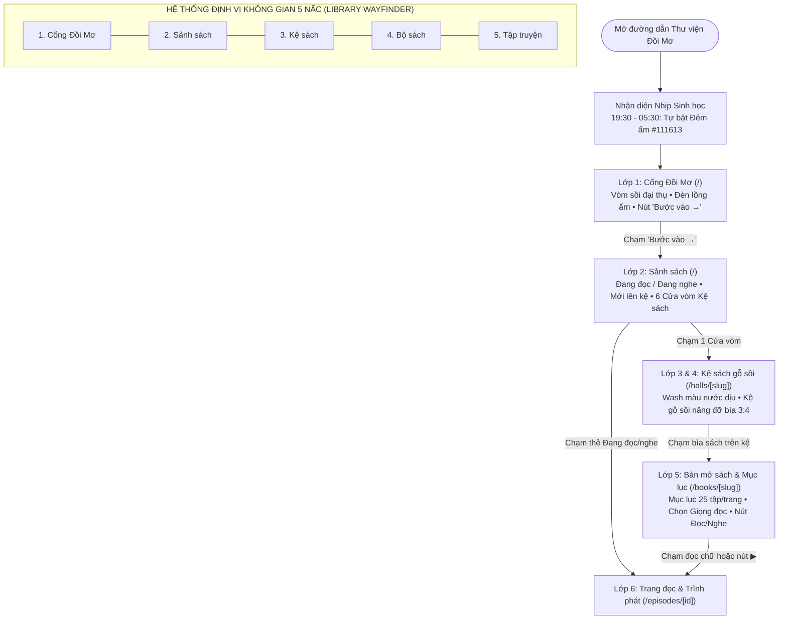
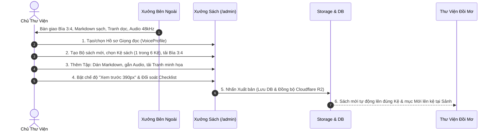

# BỘ QUY TRÌNH VẬN HÀNH CHUẨN CUỐI — THƯ VIỆN ĐỒI MƠ

| Thuộc tính | Thông tin định chuẩn |
| :--- | :--- |
| **Sản phẩm** | **Thư viện Đồi Mơ** (*Sách đọc và nghe trước giờ ngủ · Copyright © Nancy & Liti*) |
| **Hiến pháp bất biến** | [GEMINI.md](../../GEMINI.md) |
| **Tài liệu song hành** | [CAM_NANG_THU_VIEN_DOI_MO.md](./CAM_NANG_THU_VIEN_DOI_MO.md) · [PROJECT_JOURNAL.md](./PROJECT_JOURNAL.md) |
| **Mục đích** | Đóng gói trọn bộ 4 quy trình chuẩn mực, khép kín từ khâu tiếp nhận bản thảo, quản trị xuất bản `/admin`, điều hướng không gian 5 nấc đến quy chuẩn nâng cấp kỹ thuật cùng AI Agent. |

---

## TỔNG QUAN 4 QUY TRÌNH CỐT LÕI

1. **QUY TRÌNH 1:** Hành trình trải nghiệm bạn đọc qua 6 lớp không gian & Định vị 5 nấc (`LibraryWayfinder`).
2. **QUY TRÌNH 2:** Đưa sách mới và âm thanh 48kHz lên Thư viện qua Xưởng sách (`/admin`).
3. **QUY TRÌNH 3:** Chuẩn hóa media (Ảnh bìa 3:4, Tranh minh họa Brambly Hedge, Bản thu Studio 48kHz).
4. **QUY TRÌNH 4:** Đặt hàng thiết kế, nâng cấp giao diện & kiểm thử cùng AI Agent.

---

## QUY TRÌNH 1: HÀNH TRÌNH BẠN ĐỌC QUA 6 LỚP KHÔNG GIAN & ĐỊNH VỊ 5 NẤC

Quy trình này định hình toàn bộ trải nghiệm của bạn đọc thiếu nhi và gia đình vào mỗi tối trước giờ ngủ: từ tốn, ấm cúng, không áp lực tài khoản hay thông báo làm phiền.



### 1.1. Chi tiết 6 Lớp Không Gian Vận Hành

1. **Lớp 1 — Cổng Đồi Mơ (`/` khi chưa bước qua cổng):**
   - Tự động chào đón khi bắt đầu phiên mới hoặc sau `45 phút` không hoạt động.
   - Tranh vòm Ngày/Đêm (`doi-mo-day.jpg` / `doi-mo-night.jpg`) vòm sồi sum suê, vầng trăng ngoài tán lá, cột biển gỗ có đèn lồng nhỏ, mẹ con nhà cáo ngủ bên sách mở.
   - Nút **`Bước vào →`** chuyển êm ái sang Sảnh sách (`480ms`). Bất kỳ lúc nào ở bên trong, người đọc luôn có thể chạm biểu tượng Cổng gỗ (`ArchDoorIcon`) trên Wayfinder để quay lại ngắm Cổng.
2. **Lớp 2 — Sảnh sách (`/` khi đã qua cổng):**
   - **Thẻ Đang đọc / Đang nghe:** Hiển thị tối đa `2` bộ sách mở dở gần nhất, khôi phục chính xác từng giây âm thanh hoặc đúng vị trí `%` cuộn trang đọc.
   - **Kệ Mới lên kệ:** Tự động gom tối đa `3` tập mới xuất bản trong `14 ngày`, tự ẩn sau khi bạn đọc đã mở xem.
   - **Lối rẽ 6 Kệ sách:** 6 cửa vòm phân loại, kệ đã có sách thắp đèn ấm và ghi rõ số bộ/số tập; kệ trống ghi nhẹ *Sắp có sách*.
3. **Lớp 3 & 4 — Kệ sách gỗ sồi (`/halls/[slug]`):**
   - Khung tranh `StorybookHeroStage` 2/3 màn hình đầu tiên đặc trưng cho từng Kệ.
   - Sắc màu nước Preset (`Moss`, `Ochre`, `Rosewood`, `Lavender`) phủ dịu dàng.
   - Gờ kệ gỗ sồi nâng đỡ bìa sách `3:4` phẳng sạch, không tem mác cơ học.
4. **Lớp 5 — Bàn mở sách & Mục lục (`/books/[slug]`):**
   - Khung tranh bìa `3:4` lớn kèm thông tin tác giả, họa sĩ và bộ chọn giọng đọc.
   - Danh sách tập hiển thị mạch lạc: chạm tiêu đề để Đọc chữ, chạm nút tròn `▶` để Nghe ngay.
5. **Lớp 6 — Trang đọc văn học & Trình phát ru ngủ (`/episodes/[id]` & `Sleep Player`):**
   - **Thanh đỉnh dính `42px`:** Tích hợp trọn vẹn `LibraryWayfinder` 5 nấc, bộ vi điều khiển audio `[⏸ / ▶]` `0px`, nút chỉnh cỡ chữ `A- / A+` và đổi Sáng/Đêm.
   - **Mạch đọc chữ:** Tranh minh họa cuộn dọc hiển thị gọn trong khung nhìn, không chú thích vụn, không hộp bài học cuối tập.
   - **Trình phát ru ngủ:** Tính năng *Hết tập dừng êm* hạ dần âm lượng trong `8 giây` cuối qua Web Audio `GainNode`, khóa chạm trẻ em (`Kid Lock` giữ 2s).

---

## QUY TRÌNH 2: ĐƯA SÁCH VÀ ÂM THANH LÊN KỆ QUA XƯỞNG SÁCH (`/admin`)

> **Ranh giới cốt lõi:** Dự án Thư viện chỉ đảm nhận lưu trữ và trình bày sách. Các khâu sáng tác, biên tập chữ và vẽ tranh minh họa được thực hiện tại các xưởng sáng tác độc lập bên ngoài.



### Bảng Kiểm Tra Xuất Bản (Pre-Publish Checklist)

| STT | Hạng mục kiểm tra | Tiêu chuẩn bắt buộc | Đạt / Không đạt |
| :-: | :--- | :--- | :-: |
| 1 | **Tỷ lệ ảnh bìa** | Chuẩn khổ dọc `3:4`, không có chữ hay nút phát đè góc | [ ] |
| 2 | **Kệ sách chính** | Chọn đúng 1 trong 6 Kệ (hoặc Kệ giao thoa dạng `A + B`) | [ ] |
| 3 | **Bản văn Markdown** | Lọc sạch 100% hộp "Kỷ vật túi da", lời chào MC hay bài học | [ ] |
| 4 | **Dấu tiếng Việt** | Đầy đủ 134/134 ký tự có dấu, không biến dạng dấu mũ | [ ] |
| 5 | **Tệp âm thanh** | Chuẩn MP3 48kHz, gán đúng Giọng đọc, không rè xước | [ ] |
| 6 | **Tranh minh họa** | Tranh dọc 3:4 xen kẽ, không chèn chú thích caption dưới ảnh | [ ] |

---

## QUY TRÌNH 3: TIÊU CHUẨN MEDIA & ĐỒNG BỘ DỮ LIỆU

### 3.1. Tiêu Chuẩn Tranh Bìa & Minh Họa
- **Bìa sách & Bìa tập:** Khổ dọc `3:4` phẳng sạch, bo nhẹ góc `6px–8px` trên giao diện, giữ tinh thần màu nước mộc mạc của *Miền Dâu Dại*. Dung lượng tối ưu `≤ 2MB`.
- **Tranh minh họa trong bài:** Tỷ lệ dọc `3:4`, phong cách nét bút sắt mảnh (fine cross-hatching), màu nước thực vật ấm áp không ám vàng, góc nhìn ngang tầm mắt nhân vật (`30–50 cm`), không bao giờ lùi góc máy xa làm mất cảm xúc.

### 3.2. Tiêu Chuẩn Âm Thanh 48kHz
- **Định dạng file:** `MP3` hoặc `M4A` tần số mẫu `48,000 Hz` (48kHz), bitrate `128 kbps – 192 kbps`.
- **Đặt tên file chuẩn hóa:** `[Số tập]_[Mã bộ]_[Số thứ tự tập]_[Tên giọng đọc]_48kHz.mp3`  
  *(Ví dụ: `01_THD_001_Thien_Tam_Duc_48kHz.mp3`)*.
- **Hạ tầng phân phối:** Lưu trữ tại thư mục `public/audio/[slug]/` hoặc Cloudflare R2, đảm bảo hỗ trợ `HTTP 206 Range Requests`.

### 3.3. Cơ Chế Sao Lưu & Đồng Bộ Dữ Liệu
- Hệ thống hỗ trợ chế độ kép (Dual-Engine):
  - Khi chạy cục bộ: Đọc/ghi trực tiếp vào file `data/library_db.json`.
  - Khi triển khai môi trường máy chủ: Tự động kết nối Supabase PostgreSQL và Cloudflare R2.
- **Quy trình sao lưu định kỳ:** Hàng tuần, Chủ thư viện truy cập `/admin` và bấm **Sao lưu JSON** để tải tệp `library_db_backup_[timestamp].json` về máy tính an toàn.

---

## QUY TRÌNH 4: ĐẶT HÀNG NÂNG CẤP & KIỂM THỬ CÙNG AI AGENT

Khi cần bổ sung tính năng mới hoặc điều chỉnh giao diện, mọi yêu cầu đối với AI Agent phải đi qua 4 Cổng kiểm soát nghiêm ngặt:

1. **Cổng 1 — Đối soát Hiến pháp (`GEMINI.md`):**
   - Kiểm tra yêu cầu có vi phạm "5 Tuyệt đối không" hay không. Từ chối ngay các đề xuất thêm Bottom Navigation Bar, chấm điểm học tập hay biểu tượng cảm xúc OS.
2. **Cổng 2 — Kiểm duyệt Ngôn ngữ Tự nhiên:**
   - Soát lại toàn bộ nhãn nút, tiêu đề: đảm bảo không khẩu hiệu, không văn mẫu sáo rỗng, chuẩn ngôn ngữ mộc mạc đời thường.
3. **Cổng 3 — Thiết kế Thử nghiệm (nếu có màn hình mới):**
   - Tạo mockup giao diện điện thoại qua công cụ Google Stitch MCP (`deviceType: "MOBILE"`), kiểm tra trực quan trên màn hình `390px` trước khi viết code.
4. **Cổng 4 — Lập trình & Đóng gói Kiểm thử:**
   - Thi công code trong `src/**`, bảo toàn `LibraryWayfinder` 5 nấc và tính tương thích ngược của dữ liệu.
   - Chạy lệnh kiểm tra tính toàn vẹn bắt buộc trước khi bàn giao:
     ```bash
     npm run typecheck && npm run build
     ```
